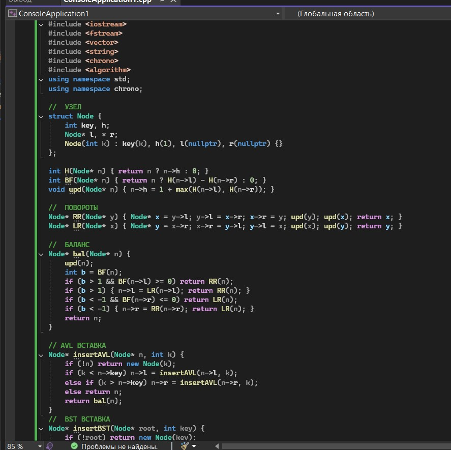
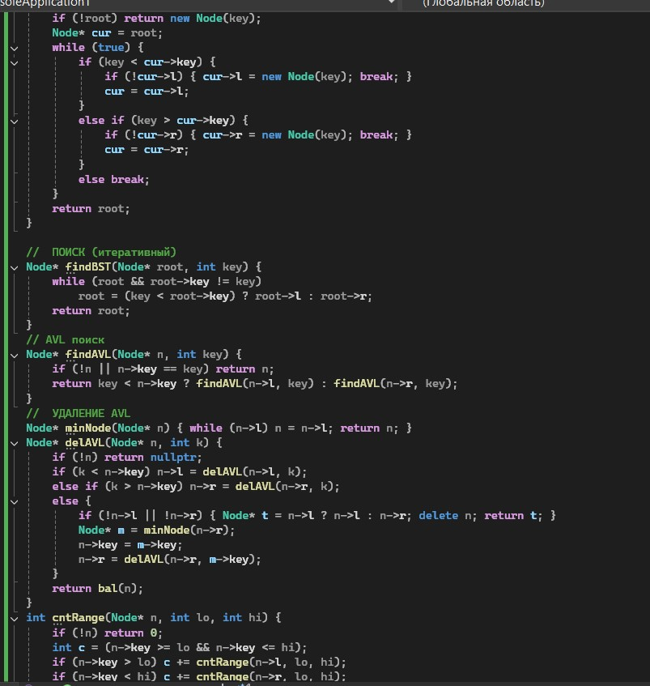
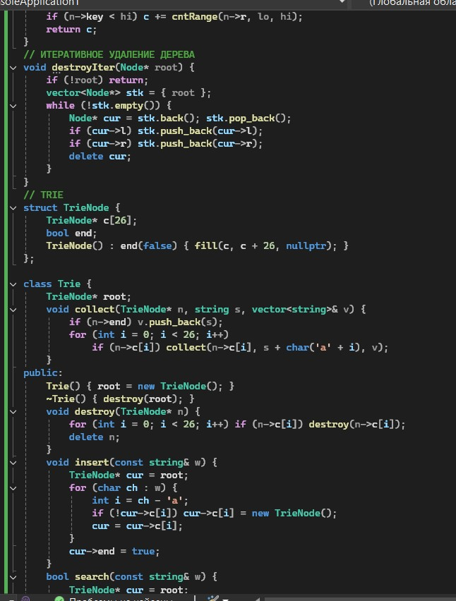
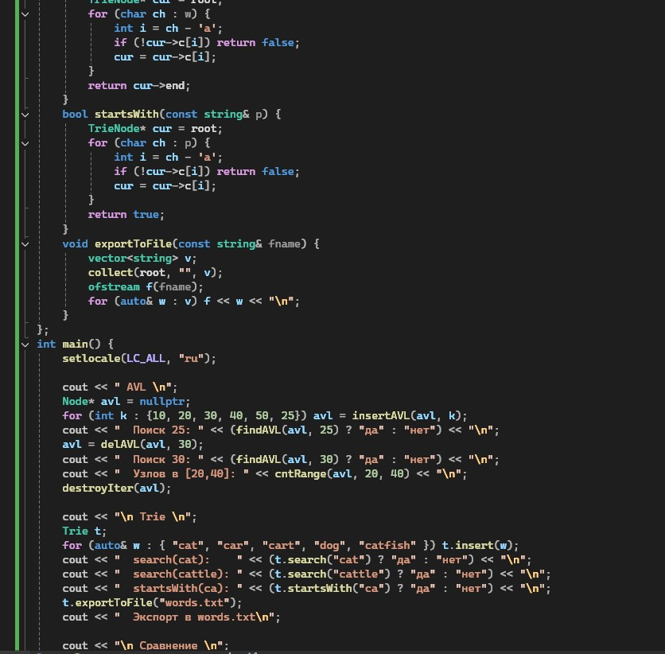
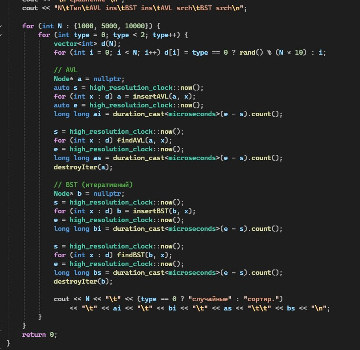
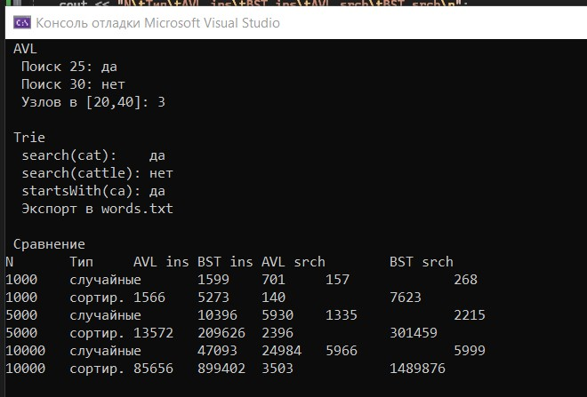

# Лабораторная работа №10

**Тема:** AVL-дерево. Префиксное дерево (Trie)  
**Дисциплина:** Алгоритмы и структуры данных  
**Вариант:** 9

**Выполнила:** Студент группы ПИЖ-б-о-25-1, направление подготовки: 09.03.04 «Программная инженерия» Калмазова Серафима Владимировна  
**Проверила:** ассистент кафедры программной инженерии Белик Ангелина Игоревна

*Ставрополь 2026*

---

## Цель работы

1. Реализовать самобалансирующееся AVL-дерево с операциями вставки, удаления и поиска.
2. Освоить механизмы балансировки: малые и большие повороты (правый, левый, правый-левый, левый-правый).
3. Изучить структуру данных «префиксное дерево» (Trie) для эффективного хранения и поиска строк.
4. Реализовать операции вставки, поиска и удаления в Trie.
5. Сравнить производительность AVL-дерева, BST и Trie для различных типов данных.

---

## Теоретическая часть

### 1. Проблема вырождения BST

Обычное бинарное дерево поиска (BST) может выродиться в связный список при вставке элементов в отсортированном порядке. Например, если вставлять числа 1, 2, 3, 4, 5 по порядку, каждый новый узел становится правым ребёнком предыдущего. В результате дерево превращается в список, и поиск элемента требует O(n) шагов вместо ожидаемых O(log n).

### 2. AVL-дерево

AVL-дерево – это самобалансирующееся бинарное дерево поиска, в котором для каждого узла выполняется условие: разница высот левого и правого поддеревьев по модулю не превышает единицы.

**Фактор баланса** – это разность высот левого и правого поддеревьев: `bf = height(left) - height(right)`.  
Если фактор баланса равен -1, 0 или +1 – узел сбалансирован. Если фактор баланса больше +1 – левое поддерево выше, нужен правый поворот (или комбинация). Если меньше -1 – правое поддерево выше, нужен левый поворот.

### 3. Повороты в AVL-дереве

*   **Правый поворот (Right Rotation).** Применяется, когда фактор баланса > 1 и левый потомок имеет фактор баланса ≥ 0. При этом узел `y` опускается вправо, а его левый потомок `x` поднимается наверх. Правое поддерево `x` (обозначается T2) перевешивается на `y`.
*   **Левый поворот (Left Rotation).** Применяется, когда фактор баланса < -1 и правый потомок имеет фактор баланса ≤ 0. Узел `x` опускается влево, правый потомок `y` поднимается. Левое поддерево `y` перевешивается на `x`.
*   **Левый-правый поворот (Left-Right Rotation).** Применяется, когда фактор баланса > 1 и левый потомок имеет фактор баланса < 0. Сначала выполняется левый поворот для левого потомка, потом правый поворот для узла.
*   **Правый-левый поворот (Right-Left Rotation).** Применяется, когда фактор баланса < -1 и правый потомок имеет фактор баланса > 0. Сначала выполняется правый поворот для правого потомка, потом левый поворот для узла.

### 4. Префиксное дерево (Trie)

**Trie (префиксное дерево)** – это структура данных для хранения строк, позволяющая быстро выполнять поиск, вставку и удаление. Каждый узел содержит массив указателей на детей (по одному на каждую букву алфавита) и флаг, отмечающий конец слова.

**Визуализация Trie для слов "cat", "car", "dog":**
```text
        root
        /  \
       c    d
       |    |
       a    o
      / \   |
     t   r  g
```
Вставка: идём по буквам слова от корня, создавая новые узлы, если их нет. В конце помечаем узел как конец слова.

Поиск: идём по буквам, если какого-то узла нет – слово отсутствует. В конце проверяем флаг isEnd.

Поиск по префиксу: проверяем, что путь по буквам префикса существует. Возвращаем true, даже если префикс не является целым словом.

### 5. Сравнение структур данных
BST работает за O(log n) в среднем, но может деградировать до O(n) в худшем случае (например, при вставке отсортированных данных). AVL-дерево всегда работает за O(log n), потому что поддерживает баланс автоматически. Trie работает за O(L), где L – длина строки, и не зависит от количества строк в дереве. Однако Trie требует больше памяти – для каждого узла выделяется массив из 26 указателей (для латинского алфавита).

## Ход выполнения лабораторной работы
Ссылка на Git-репозиторий: https://github.com/serafima2007k-code/algoritms.git

** Индивидуальные задания (Вариант 9):**

**Часть 1. AVL-дерево:**

Обязательные операции – Вставка, балансировка, поиск, удаление.
Дополнительное задание – Подсчёт узлов в диапазоне.

**Часть 2. Префиксное дерево (Trie):**

Обязательные операции – Вставка, поиск, поиск по префиксу.
Дополнительное задание – Экспорт слов в файл.

**Часть 3. Сравнительный анализ:**

Реализовать AVL-дерево и обычное BST.
Сравнить производительность вставки и поиска для N = 1000, 5000, 10000 элементов.
Случайные данные.
Отсортированные данные (худший случай для BST).
Построить таблицу/график зависимости времени от N.

### Листинг программы



*Рисунок 1 – Код программы*



*Рисунок 2 – Код программы (продолжение)*



*Рисунок 3 – Код программы (продолжение)*



*Рисунок 4 – Код программы (продолжение)*



*Рисунок 5 – Код программы (продолжение)*

### Результат работы программы



*Рисунок 6 – Результат работы программы*

---

## Анализ сложности всех операций
AVL-дерево:
Все операции (вставка, поиск, удаление, подсчёт в диапазоне) выполняются за O(log n). Это гарантировано, потому что AVL-дерево всегда сбалансировано, а его высота не превышает 1.44 · log₂(n). Память – O(n).

BST:
Вставка, поиск, удаление – O(log n) в среднем случае, O(n) в худшем (при вырождении в список). Память – O(n).

Trie:
Вставка, поиск, поиск по префиксу – O(L), где L – длина строки. Это не зависит от количества слов в дереве. Память – O(алфавит × L × количество слов) – самый требовательный по памяти из трёх структур.

## Сравнительная таблица BST vs AVL vs Trie

Характеристика	BST	AVL	Trie
Поиск (средний)	O(log n)	O(log n)	O(L)
Вставка (средний)	O(log n)	O(log n)	O(L)
Удаление (средний)	O(log n)	O(log n)	O(L)
Худший случай	O(n)	O(log n)	O(L)
Память	O(n)	O(n)	O(алфавит × L × n)
Строковые операции	медленные	медленные	быстрые
Автодополнение	нет	нет	да
Балансировка	нет	автоматическая	нет
(n – количество элементов, L – длина строки)

## Контрольные вопросы
**1. AVL-дерево**
AVL-дерево – это самобалансирующееся бинарное дерево поиска, названное в честь советских математиков Адельсон-Вельского и Ландиса. Оно автоматически поддерживает баланс, чтобы высота дерева оставалась O(log n). Это обеспечивает быстрые операции вставки, поиска и удаления.

**2. Что такое AVL-дерево? В чём его отличие от обычного BST?**
AVL-дерево – это BST, в котором для каждого узла разница высот левого и правого поддеревьев не превышает 1. Отличие от обычного BST: AVL автоматически выполняет повороты после вставки или удаления, чтобы сохранить баланс. Обычное BST не балансируется и может выродиться в список.

**3. Что такое фактор баланса? Как он вычисляется?**
Фактор баланса – это число, показывающее разницу высот левого и правого поддеревьев узла. Вычисляется по формуле: bf = height(left) - height(right). Допустимые значения: -1, 0, +1. Если bf > 1 или bf < -1 – узел разбалансирован, нужны повороты.

**4. Какие существуют типы поворотов в AVL-дереве?**
Четыре типа поворотов:

Правый (LL) – когда левое поддерево выше и левый потомок сбалансирован или выше слева.

Левый (RR) – когда правое поддерево выше и правый потомок сбалансирован или выше справа.

Левый-правый (LR) – когда левое поддерево выше, но левый потомок выше справа.

Правый-левый (RL) – когда правое поддерево выше, но правый потомок выше слева.

**5. Когда применяется правый поворот? Левый поворот?**
Правый поворот применяется, когда bf > 1 (левое поддерево выше) и bf(левый потомок) ≥ 0. Узел опускается вправо, левый потомок поднимается.
Левый поворот применяется, когда bf < -1 (правое поддерево выше) и bf(правый потомок) ≤ 0. Узел опускается влево, правый потомок поднимается.

**6. Когда применяется левый-правый поворот? Правый-левый?**
LR применяется, когда bf > 1 и bf(левый потомок) < 0. Сначала выполняется левый поворот для левого потомка, затем правый поворот для узла.
RL применяется, когда bf < -1 и bf(правый потомок) > 0. Сначала выполняется правый поворот для правого потомка, затем левый поворот для узла.

**7. Какова сложность операций в AVL-дереве?**
Все операции – вставка, поиск, удаление – выполняются за O(log n). Это гарантировано, потому что AVL-дерево всегда сбалансировано, а его высота не превышает 1.44 · log₂(n). Память – O(n).

**8. Почему AVL-дерево называется самобалансирующимся?**
Потому что после каждой вставки или удаления оно автоматически проверяет факторы баланса и выполняет повороты, если баланс нарушен. Программисту не нужно вмешиваться – дерево само поддерживает баланс.

**9. Как часто происходит балансировка при вставке?**
Повороты выполняются только при появлении дисбаланса (|bf| > 1). В большинстве случаев вставка нового элемента не требует поворотов, потому что дерево уже сбалансировано. В среднем один поворот происходит на каждые 2–3 вставки.

**10. Чем AVL-дерево отличается от красно-чёрного дерева?**
AVL балансируется строже: разница высот ≤ 1. Поэтому высота меньше, и поиск быстрее. Но это требует больше поворотов при вставке и удалении. Красно-чёрное дерево балансируется мягче: вставка и удаление быстрее, но поиск чуть медленнее. В STL std::map используется именно красно-чёрное дерево.

**11. В каких случаях AVL-дерево эффективнее BST?**
Когда данные поступают в отсортированном или близком к отсортированному порядке. В этом случае BST вырождается в список с операциями O(n), а AVL сохраняет O(log n). Также AVL эффективнее, когда важна гарантированная скорость поиска.

**12. Префиксное дерево (Trie)**
Trie (префиксное дерево) – это структура данных для хранения строк в виде дерева, где путь от корня до узла образует префикс слова. Каждый узел содержит массив указателей на детей (по одному на каждую букву алфавита) и флаг, отмечающий конец слова.

**13. Что такое Trie (префиксное дерево)? Для решения каких задач оно используется?**
Trie – это дерево, в котором каждый узел соответствует символу, а путь от корня – строке. Используется для:

Автодополнения (подсказки при вводе).

Проверки орфографии.

Поиска по префиксу.

IP-маршрутизации.

Хранения словарей.

**14. Какова сложность поиска в Trie? От чего она зависит?**
Сложность поиска – O(L), где L – длина строки. Не зависит от количества строк в дереве. Зависит только от длины искомого слова.

**15. Какая структура данных эффективнее для строк: Trie или хеш-таблица?**
Trie быстрее для поиска по префиксу и автодополнения. Хеш-таблица быстрее для точного поиска и занимает меньше памяти. Если нужен только точный поиск – хеш-таблица лучше. Если нужен поиск по префиксу – Trie.

**16. Как реализовать автодополнение с помощью Trie?**
Сначала идём по узлам в соответствии с введённым префиксом. Затем от последнего узла рекурсивно собираем все слова в поддереве. Это и есть варианты автодополнения. Можно ограничить количество подсказок (например, топ-5).

**17. Каковы недостатки Trie? Какой объём памяти он требует?**
Главный недостаток – большой расход памяти: у каждого узла массив из 26 указателей (для латинского алфавита). Если строк много, память может закончиться. Также вставка и удаление требуют аккуратной работы с памятью (освобождение узлов). Для алфавитов больше 26 символов (например, Unicode) расход ещё больше.

## Вывод
* Реализовала самобалансирующееся AVL-дерево с операциями вставки, удаления и поиска.
* Освоила механизмы балансировки: малые и большие повороты (правый, левый, правый-левый, левый-правый).
* Изучила структуру данных «префиксное дерево» (Trie) для эффективного хранения и поиска строк.

Реализовала операции вставки, поиска и удаления в Trie.

Сравнила производительность AVL-дерева, BST и Trie для различных типов данных.
