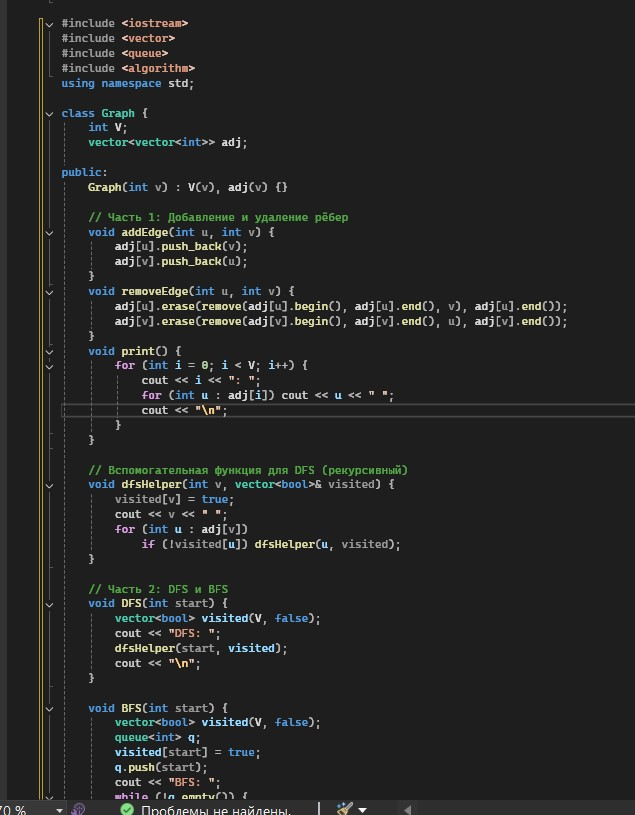
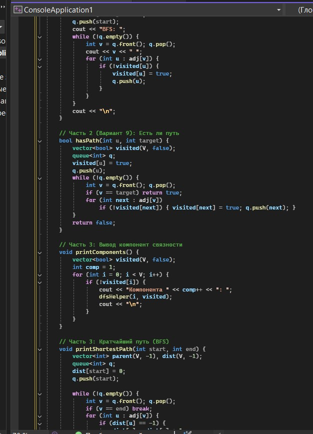
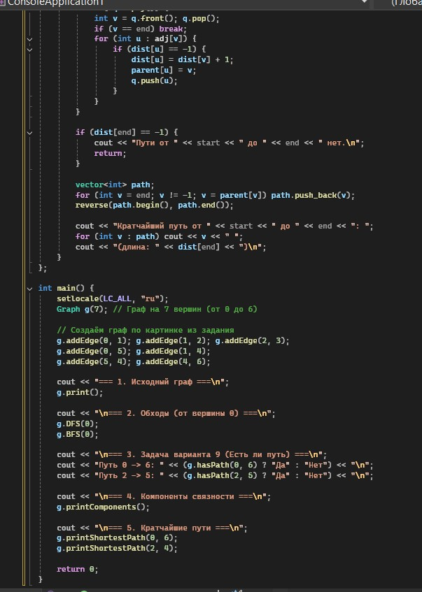
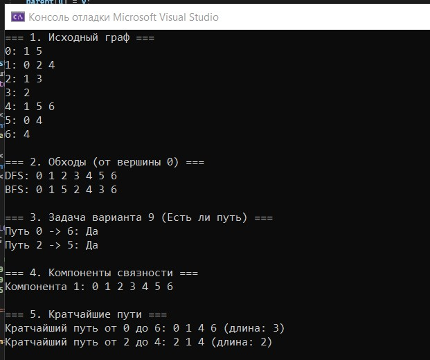

# Лабораторная работа №11

**Тема:** Представление графов. DFS и BFS  
**Дисциплина:** Алгоритмы и структуры данных  
**Вариант:** 9

**Выполнила:** Студент группы ПИЖ-б-о-25-1, направление подготовки: 09.03.04 «Программная инженерия» Калмазова Серафима Владимировна  
**Проверила:** ассистент кафедры программной инженерии Белик Ангелина Игоревна

*Ставрополь 2026*

---

## Цель работы

1. Изучить способы представления графов в памяти компьютера: матрица смежности и список смежности.
2. Освоить алгоритмы обхода графа: поиск в глубину (DFS) и поиск в ширину (BFS).
3. Научиться применять DFS и BFS для решения практических задач (поиск компонент связности, кратчайших путей).
4. Проанализировать сложность алгоритмов для разных способов представления графа.
5. Сравнить эффективность матрицы смежности и списка смежности.

---

## Теоретическая часть

### 1. Основные понятия теории графов

**Граф** – это совокупность вершин (узлов) и рёбер (связей) между ними.

**Вершина (vertex)** – узел графа. **Ребро (edge)** – связь между двумя вершинами.

**Ориентированный граф** – рёбра имеют направление (стрелки). **Неориентированный граф** – рёбра без направления.

**Взвешенный граф** – рёбра имеют веса (стоимость прохода).

**Степень вершины** – количество рёбер, инцидентных вершине.

**Путь** – последовательность вершин, соединённых рёбрами. **Цикл** – путь, начинающийся и заканчивающийся в одной вершине.

**Компонента связности** – максимальное множество вершин, любые две из которых соединены путём.

### 2. Способы представления графов

**Матрица смежности** – квадратная матрица V×V, где `matrix[i][j] = 1`, если есть ребро из i в j. Память: O(V²). Быстрая проверка ребра (O(1)), но много памяти для разреженных графов.

**Список смежности** – массив списков, где для каждой вершины хранится список смежных с ней вершин. Память: O(V + E). Эффективен для разреженных графов, перебор соседей за O(deg(u)).

### 3. Поиск в глубину (DFS)

DFS идёт «в глубину», пока не достигнет тупика, затем возвращается и исследует другие пути. Реализуется рекурсивно или через стек. Сложность: O(V + E) для списка смежности.

### 4. Поиск в ширину (BFS)

BFS посещает все соседние вершины, затем их соседей (по уровням). Реализуется через очередь. Сложность: O(V + E) для списка смежности. Находит кратчайший путь в невзвешенном графе.

---

## Ход выполнения лабораторной работы

**Ссылка на Git-репозиторий:** [https://github.com/serafima2007k-code/algoritms.git](https://github.com/serafima2007k-code/algoritms.git)

**Индивидуальные задания (Вариант 9):**

**Часть 1. Представление графов:**
*   Способ представления – Список смежности.
*   Тип графа – Неориентированный.
*   Особенности – Разреженный.

**Часть 2. Обход графов (DFS и BFS):**
*   Алгоритмы – DFS (рекурсивный), BFS.
*   Задача – Определить, есть ли путь между вершинами.

**Часть 3. Применение обходов:**
1. Создаёт граф по заданию (количество вершин и рёбер).
2. Выполняет обход DFS и BFS, начиная с указанной вершины.
3. Находит все компоненты связности и выводит их.
4. Для выбранной пары вершин находит кратчайший путь (BFS).
5. Выводит результаты в наглядной форме.

**Пример графа (для тестирования):**
```text
0 - 1 - 2 - 3
|   |
5 - 4 - - 6
```

## Листинг программы


*Рисунок 1 – Код программы*



*Рисунок 2 – Код программы (продолжение)*



*Рисунок 3 – Код программы (продолжение)*


### Результат работы программы



*Рисунок 4 – Результат работы программы*

---
## Анализ сложности всех операций
|Операция	|Сложность|
| :--- | :--- |
|Добавление ребра|	O(1)|
|Удаление ребра|	O(deg(u))|
|Проверка наличия ребра|	O(deg(u))|
|Перебор всех соседей	|O(deg(u))|
|DFS (рекурсивный/итеративный)|O(V + E)|
|BFS|	O(V + E)|
|Поиск компонент связности|	O(V + E)|
|Поиск кратчайшего пути (BFS)	|O(V + E)|

## Контрольные вопросы

**1. Что такое граф? Из каких элементов он состоит?**
Граф – это совокупность вершин (узлов) и рёбер (связей) между ними. Состоит из множества вершин V и множества рёбер E.

**2. Чем отличается ориентированный граф от неориентированного?**
В ориентированном графе рёбра имеют направление (стрелки), в неориентированном – нет. В неориентированном ребро (u, v) = ребро (v, u), в ориентированном – это разные рёбра.

**3. Что такое матрица смежности? Каковы её достоинства и недостатки?**
Матрица V×V, где m[i][j] = 1, если есть ребро i→j. Достоинства: быстрая проверка ребра за O(1), простота реализации. Недостатки: память O(V²), неэффективна для разреженных графов.

**4. Что такое список смежности? Каковы его достоинства и недостатки?**
Массив списков, где для каждой вершины хранятся соседи. Достоинства: память O(V+E), быстрый перебор соседей. Недостатки: проверка ребра за O(deg(u)) – медленнее, чем в матрице.

**5. В каких случаях лучше использовать матрицу смежности, а в каких – список?**
Матрица – для плотных графов (E ≈ V²), когда нужна быстрая проверка рёбер. Список – для разреженных графов (E << V²), когда важна экономия памяти.

**6. Сложность проверки наличия ребра в матрице? В списке?**
В матрице – O(1). В списке – O(deg(u)).

**7. Сложность перебора всех соседей вершины в матрице? В списке?**
В матрице – O(V) (нужно пройти всю строку). В списке – O(deg(u)).

**8. Что такое поиск в глубину (DFS)? Как он работает?**
DFS – обход «в глубину»: идём по одному пути до конца, затем возвращаемся и идём по-другому. Реализуется рекурсией или стеком.

**9. Какие задачи решаются с помощью DFS?**
Поиск компонент связности, проверка циклов, топологическая сортировка, поиск мостов и точек сочленения, поиск пути.

**10. Что такое поиск в ширину (BFS)? Как он работает?**
BFS – обход «по уровням»: сначала все соседи, потом их соседи. Использует очередь.

**11. Какие задачи решаются с помощью BFS?**
Кратчайший путь в невзвешенном графе, поиск компонент связности, проверка двудольности, поиск на заданном расстоянии.

**12. В чём отличие рекурсивной реализации DFS от итеративной?**
Рекурсивная использует системный стек вызовов, итеративная – собственный стек. Итеративная может избежать переполнения стека при больших графах.

**13. Почему BFS находит кратчайший путь, а DFS – нет?**
BFS идёт по уровням: сначала все на расстоянии 1, потом 2 и т.д. Поэтому первый найденный путь – кратчайший. DFS идёт «вглубь» и может найти длинный путь раньше короткого.

**14. Как найти компоненты связности с помощью DFS?**
Запускаем DFS из каждой непосещённой вершины. Каждый запуск соответствует одной компоненте связности.

** 15. Как проверить наличие цикла в графе с помощью DFS?**
При обходе, если встречаем уже посещённого соседа (не родителя), – есть цикл. Для неориентированного графа это работает так: если сосед посещён и не является родителем текущей вершины, есть цикл.

## Вывод
* Изучила способы представления графов в памяти компьютера: матрица смежности и список смежности.
* Освоила алгоритмы обхода графа: поиск в глубину (DFS) и поиск в ширину (BFS).
* Научилась применять DFS и BFS для решения практических задач (поиск компонент связности, кратчайших путей).
* Проанализировала сложность алгоритмов для разных способов представления графа.
 * Сравнила эффективность матрицы смежности и списка смежности.