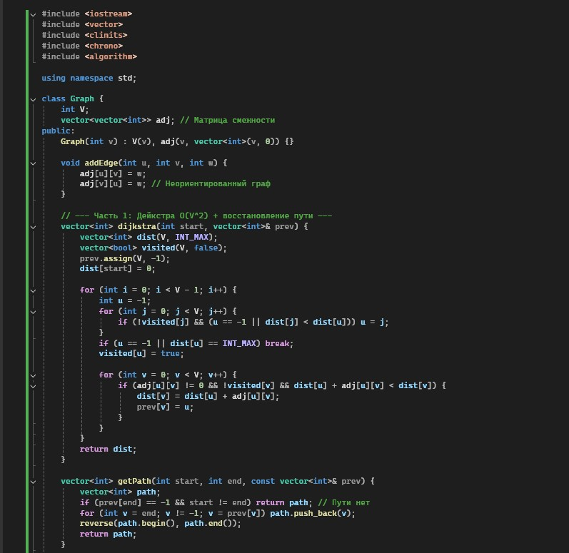
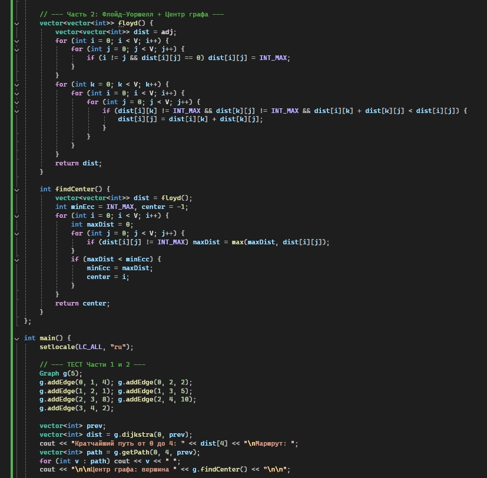
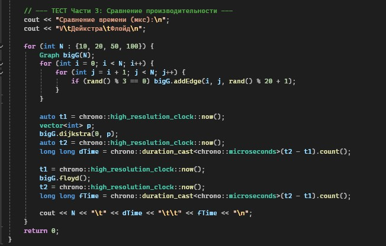
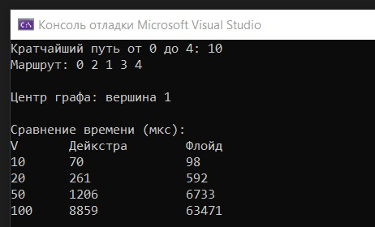

# Лабораторная работа №12

**Тема:** Алгоритм Дейкстры. Алгоритм Флойда-Уоршелла  
**Дисциплина:** Алгоритмы и структуры данных  
**Вариант:** 9

**Выполнила:** Студент группы ПИЖ-б-о-25-1, направление подготовки: 09.03.04 «Программная инженерия» Калмазова Серафима Владимировна  
**Проверила:** ассистент кафедры программной инженерии Белик Ангелина Игоревна

*Ставрополь 2026*

---

## Цель работы

1. Реализовать алгоритм Дейкстры для нахождения кратчайших путей от одной вершины до всех остальных во взвешенном графе с неотрицательными весами.
2. Реализовать алгоритм Флойда-Уоршелла для нахождения кратчайших путей между всеми парами вершин.
3. Изучить особенности работы алгоритмов с графами, содержащими отрицательные веса.
4. Научиться восстанавливать кратчайшие пути после выполнения алгоритмов.
5. Сравнить временную сложность и области применения алгоритмов.

---

## Теоретическая часть

### 1. Постановка задачи

Задача поиска кратчайшего пути – одна из классических задач теории графов. Требуется найти путь между двумя вершинами графа, сумма весов рёбер которого минимальна.

**Алгоритм Дейкстры** ищет кратчайшие пути от одной вершины до всех остальных. Сложность O((V+E) log V) с приоритетной очередью или O(V²) без оптимизации. Не допускает отрицательных весов.

**Алгоритм Флойда-Уоршелла** ищет кратчайшие пути между всеми парами вершин. Сложность O(V³). Допускает отрицательные веса (при отсутствии отрицательных циклов).

### 2. Алгоритм Дейкстры

Жадный алгоритм. На каждом шаге выбирает вершину с наименьшим известным расстоянием и релаксирует её соседей: если через текущую вершину можно дойти до соседа быстрее, расстояние обновляется.

**Условие применимости:** все веса рёбер должны быть неотрицательными. Иначе жадная стратегия даёт неверный результат.

**Восстановление пути:** вместе с массивом расстояний `dist` хранится массив `prev`, где `prev[v]` – предшественник вершины v на кратчайшем пути. Пройдя от конца к началу по `prev`, получаем путь.

### 3. Алгоритм Флойда-Уоршелла

Динамическое программирование. На k-й итерации разрешается использовать вершины 0..k в качестве промежуточных. Формула:

```text
dist[i][j] = min(dist[i][j], dist[i][k] + dist[k][j])
```

Обнаружение отрицательных циклов: если после работы алгоритма dist[i][i] < 0, значит, есть отрицательный цикл, проходящий через i.

Восстановление пути: хранится матрица next[i][j] – следующая вершина на пути от i к j. Путь восстанавливается пошагово.

## Ход выполнения лабораторной работы
Ссылка на Git-репозиторий: https://github.com/serafima2007k-code/algoritms.git

Индивидуальные задания (Вариант 9):

** Часть 1. Алгоритм Дейкстры:**

Способ реализации: Без оптимизации (O(V²)).

Особенности: Поиск пути между двумя вершинами.

**Часть 2. Алгоритм Флойда-Уоршелла:**

Особенности: Неориентированный граф.

Дополнительное задание: Нахождение центра графа.

**Часть 3. Сравнительный анализ:**

* Реализовать граф на 20 вершин со случайными весами рёбер.
* Выполнить алгоритм Дейкстры для случайной стартовой вершины.
* Выполнить алгоритм Флойда-Уоршелла.
* Сравнить результаты (расстояния между одними и теми же парами).
* Измерить время выполнения для V = 10, 20, 50, 100.
* Построить график зависимости времени от V.

## Листинг программы


*Рисунок 1 – Код программы*



*Рисунок 2 – Код программы (продолжение)*



*Рисунок 3 – Код программы (продолжение)*


### Результат работы программы



*Рисунок 4 – Результат работы программы*

---

## Анализ сложности
* Алгоритм Дейкстры (без оптимизации):

Время: O(V²) – внешний цикл V раз, поиск минимума V раз, релаксация V раз.

Память: O(V) – массивы dist, prev, visited.

С приоритетной очередью: O((V + E) log V).

* Алгоритм Флойда-Уоршелла:

Время: O(V³) – три вложенных цикла по V.

Память: O(V²) – матрица расстояний.

* Сравнение:

На графах с V = 100: Дейкстра в ~14 раз быстрее Флойда.

С ростом V разрыв увеличивается (O(V²) против O(V³)).

## Сравнительная таблица
|Алгоритм	|Назначение	|Сложность	|Отрицательные веса	|Память|
| :--- | :--- | :--- | :--- |:--- |
|Дейкстра	|От одной вершины до всех|	O((V+E) log V) или O(V²)	|Не допускаются	|O(V)|
|Флойд-Уоршелл	|Между всеми парами|	O(V³)	|Допускаются (без циклов)|	O(V²)|

## Контрольные вопросы
1. Какие условия должны выполняться для корректной работы алгоритма Дейкстры?
Все веса рёбер должны быть неотрицательными. Граф может быть ориентированным или неориентированным. Вершины должны быть связаны рёбрами (для недостижимых вершин расстояние остаётся бесконечным).

2. Почему алгоритм Дейкстры не работает с отрицательными весами?
Алгоритм жадный: он предполагает, что как только вершина выбрана как ближайшая, её расстояние уже окончательное. При отрицательных весах может оказаться, что через другую вершину до неё можно дойти ещё быстрее. Жадный выбор даёт неверный результат.

3. Какова временная сложность алгоритма Дейкстры с приоритетной очередью?
O((V + E) log V), где V – количество вершин, E – количество рёбер. Для разреженных графов (E ≈ V) это близко к O(V log V).

4. В чём заключается идея алгоритма Флойда-Уоршелла?
Идея динамического программирования. На k-й итерации разрешается использовать вершины 0..k в качестве промежуточных. Постепенно, увеличивая k, находим кратчайшие пути между всеми парами.

5. Какова временная сложность алгоритма Флойда-Уоршелла?
O(V³) – три вложенных цикла по количеству вершин. Память – O(V²).

6. Как алгоритм Флойда-Уоршелла обнаруживает отрицательные циклы?
После завершения алгоритма проверяется диагональ матрицы: если dist[i][i] < 0, значит, существует отрицательный цикл, проходящий через вершину i.

7. В каких случаях предпочтительнее использовать алгоритм Дейкстры?
Когда нужны кратчайшие пути от одной вершины до всех остальных, и граф разреженный. Дейкстра быстрее Флойда (O(V²) или O(V log V) против O(V³)).

8. В каких случаях предпочтительнее использовать алгоритм Флойда-Уоршелла?
Когда нужны кратчайшие пути между всеми парами вершин, или когда в графе есть отрицательные веса (но не циклы). Также когда граф плотный и V невелико (до ~500).

9. Как восстановить кратчайший путь после выполнения алгоритма Дейкстры?
Используется массив prev, где prev[v] – предшественник вершины v. Идём от конца к началу по prev, затем разворачиваем путь.

10. Как восстановить кратчайший путь после выполнения алгоритма Флойда-Уоршелла?
Хранится матрица next[i][j] – следующая вершина на пути от i к j. Начинаем с u = start, добавляем u, затем u = next[u][end], пока не дойдём до end.

11. Что такое релаксация в контексте алгоритмов поиска кратчайших путей?
Релаксация – это обновление расстояния до вершины, если найден более короткий путь. Если dist[u] + weight(u, v) < dist[v], то dist[v] обновляется.

12. Как можно оптимизировать алгоритм Дейкстры для разреженных графов?
Использовать приоритетную очередь (binary heap или Fibonacci heap). Это даёт O((V + E) log V) вместо O(V²). Для разреженных графов это существенно быстрее.

13. Какую память требует алгоритм Флойда-Уоршелла?
O(V²) – матрица расстояний размером V×V. Для V = 1000 это ~4 МБ (при int), для V = 10000 – ~400 МБ.

14. При каком количестве вершин алгоритм Флойда-Уоршелла становится неприменимым?
Практически – при V > 1000 (O(V³) даёт ~10⁹ операций, что уже долго). При V > 5000 алгоритм становится слишком медленным для практических задач.

15. Как модифицировать алгоритм Дейкстры для нахождения второго кратчайшего пути?
Нужно хранить не одно расстояние dist[v], а два: минимальное и второе минимальное. При релаксации обновлять оба значения.

## Вывод
* Реализовала алгоритм Дейкстры для нахождения кратчайших путей от одной вершины до всех остальных во взвешенном графе с неотрицательными весами.
* Реализовала алгоритм Флойда-Уоршелла для нахождения кратчайших путей между всеми парами вершин.
* Изучила особенности работы алгоритмов с графами, содержащими отрицательные веса.
* Научилась восстанавливать кратчайшие пути после выполнения алгоритмов.
* Сравнила временную сложность и области применения алгоритмов.