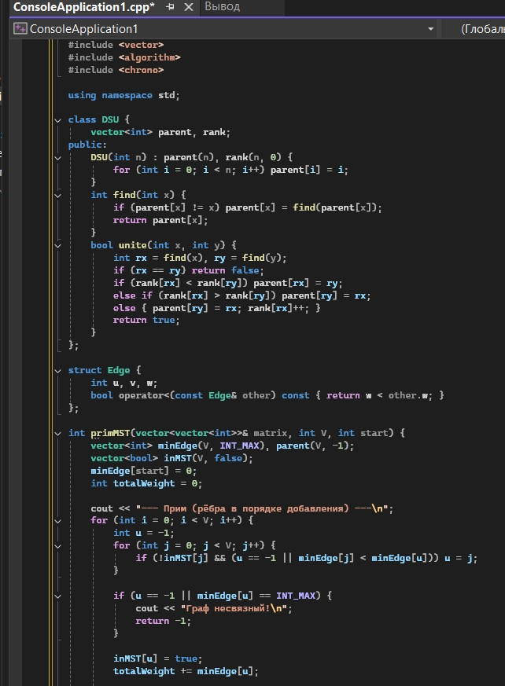
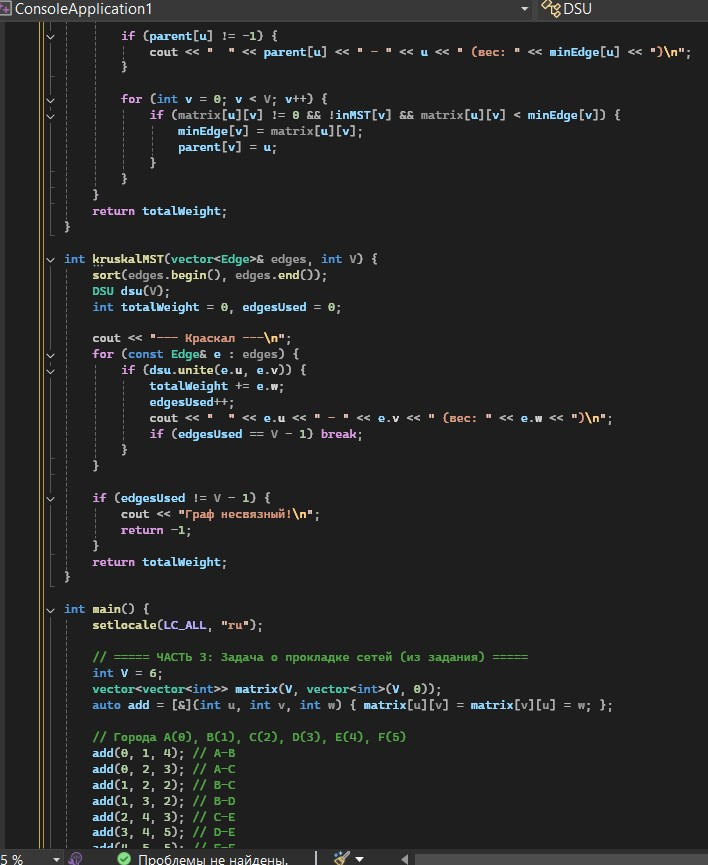
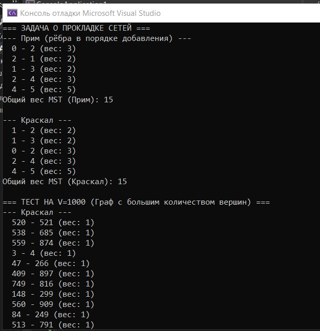
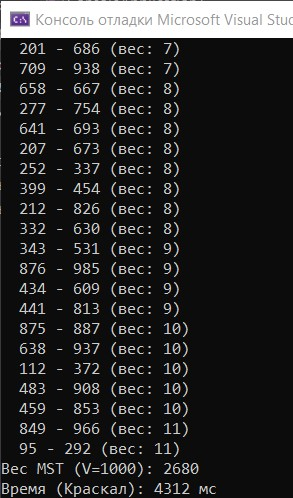

# Лабораторная работа №13

**Тема:** Алгоритмы Прима и Краскала. Минимальное остовное дерево  
**Дисциплина:** Алгоритмы и структуры данных  
**Вариант:** 9

**Выполнила:** Студент группы ПИЖ-б-о-25-1, направление подготовки: 09.03.04 «Программная инженерия» Калмазова Серафима Владимировна  
**Проверила:** ассистент кафедры программной инженерии Белик Ангелина Игоревна

*Ставрополь 2026*

---

## Цель работы

1. Изучить понятие минимального остовного дерева (Minimum Spanning Tree, MST) и его применение.
2. Реализовать алгоритм Прима для построения MST в связном взвешенном графе.
3. Реализовать алгоритм Краскала для построения MST с использованием системы непересекающихся множеств (DSU).
4. Сравнить эффективность алгоритмов Прима и Краскала на различных типах графов.
5. Научиться применять MST для решения практических задач (сети связи, дорожные сети).

---

## Теоретическая часть

### 1. Понятие минимального остовного дерева

**Остовное дерево (Spanning Tree)** – это подграф связного графа, который содержит все вершины исходного графа, является деревом (не содержит циклов) и имеет ровно V–1 рёбер.

**Минимальное остовное дерево (MST)** – остовное дерево с минимальной суммой весов рёбер.

**Свойства MST:**
*   **Единственность:** если все веса рёбер различны, MST единственно.
*   **Свойство разреза:** минимальное ребро, пересекающее любой разрез, принадлежит MST.
*   **Свойство цикла:** максимальное ребро в любом цикле не принадлежит MST.

### 2. Алгоритм Прима

Жадный алгоритм. Начинает с одной вершины и на каждом шаге добавляет минимальное ребро, соединяющее текущее дерево с ещё не включённой вершиной. Сложность: O(V²) на матрице смежности, O((V+E) log V) с приоритетной очередью.

### 3. Алгоритм Краскала

Сортирует все рёбра по весу и добавляет их в MST, если они не создают цикл. Для проверки цикла используется DSU. Сложность: O(E log E).

### 4. Система непересекающихся множеств (DSU)

DSU – структура данных для объединения множеств и проверки принадлежности элементов одному множеству. Операции `find` (со сжатием пути) и `unite` (по рангу) работают почти за O(1).

---

## Ход выполнения лабораторной работы

**Ссылка на Git-репозиторий:** [https://github.com/serafima2007k-code/algoritms.git](https://github.com/serafima2007k-code/algoritms.git)

**Индивидуальные задания (Вариант 9):**

**Часть 1. Алгоритм Прима:**
*   Способ реализации – Без оптимизации (O(V²)).
*   Особенности – Вывод рёбер в порядке добавления.

**Часть 2. Алгоритм Краскала:**
*   Особенности – Простая сортировка.
*   Дополнительное задание – Граф с большим количеством вершин (V=1000).

**Часть 3. Применение MST:**
Реализовать программу для решения задачи о прокладке сетей. Дано N городов и M возможных дорог между ними с указанием стоимости строительства.
1. Найти минимальную стоимость соединения всех городов (MST).
2. Вывести список дорог, которые нужно построить.
3. Если граф не связный, вывести компоненты связности.

**Пример входных данных:** Города: A, B, C, D, E, F
Дороги: A-B: 4, A-C: 3, B-C: 2, B-D: 2, C-E: 3, D-E: 5, E-F: 5
**Ожидаемый результат:** Минимальная стоимость: 16
Дороги для строительства: B-C (2), B-D (2), A-C (3), C-E (3), E-F (5)

### Листинг программы

*Рисунок 1 – Код программы*

*Рисунок 2 – Код программы (продолжение)*

*Рисунок 3 – Код программы (продолжение)*

### Результат работы программы

*Рисунок 4 – Результат работы программы*

*Рисунок 5 – Результат работы программы*

## Анализ сложности
|Алгоритм	|Временная сложность	|Память|
| :--- | :--- | :--- |
|Прим (O(V²))	|O(V²)	|O(V²)|
|Прим (priority_queue)	|O((V+E) log V)	|O(V+E)|
|Краскал	|O(E log E)|	O(V+E)|

Для плотных графов (E ≈ V²) Прим O(V²) эффективнее, для разреженных – Краскал.

## Сравнительная таблица
|Характеристика|	Прим	|Краскал|
| :--- | :--- | :--- |
|Тип графа	|Неориентированный|	Неориентированный|
|Идея	|Расширение дерева от вершины	|Сортировка рёбер + DSU|
|Сложность	|O(V²) или O(E log V)|	O(E log E)|
|Лучше для	|Плотных графов	|Разреженных графов|
|Структура данных	|Матрица/список + приоритетная очередь|	Список рёбер + DSU|

## Контрольные вопросы
1. Что такое минимальное остовное дерево (MST)?
MST – это остовное дерево связного графа с минимальной суммой весов рёбер. Содержит все вершины, V–1 рёбер, не имеет циклов.

2. Какие свойства имеет MST?
Единственность (при различных весах), свойство разреза (минимальное ребро через разрез принадлежит MST), свойство цикла (максимальное ребро в цикле не входит в MST).

3. В чём заключается идея алгоритма Прима?
Начинаем с одной вершины и постепенно расширяем дерево, добавляя на каждом шаге минимальное ребро, соединяющее дерево с новой вершиной.

4. Какова временная сложность алгоритма Прима на матрице смежности?
O(V²) – два вложенных цикла по V.

5. Какова временная сложность алгоритма Прима с приоритетной очередью?
O((V+E) log V) – для разреженных графов быстрее, чем O(V²).

6. В чём заключается идея алгоритма Краскала?
Сортируем все рёбра по весу и добавляем их в MST, если они не создают цикл (проверка через DSU).

7. Что такое DSU и как она используется в алгоритме Краскала?
DSU – система непересекающихся множеств. Используется для проверки, принадлежат ли концы ребра одному компоненту (если да – ребро создаст цикл).

8. Какова временная сложность алгоритма Краскала?
O(E log E) из-за сортировки рёбер. DSU работает почти за O(1).

9. В каких случаях алгоритм Прима эффективнее алгоритма Краскала?
На плотных графах (E ≈ V²), где O(V²) лучше O(E log E).

10. В каких случаях алгоритм Краскала эффективнее алгоритма Прима?
На разреженных графах (E << V²), где O(E log E) значительно меньше O(V²).

11. Как проверить, что построенное дерево является минимальным?
Сравнить сумму весов с другими алгоритмами или использовать свойство разреза: для любого разреза минимальное пересекающее ребро должно быть в дереве.

12. Что произойдёт, если граф не связный?
MST не существует. Можно построить минимальный остовный лес (для каждой компоненты – своё дерево).

13. Как модифицировать алгоритмы для поиска максимального остовного дерева?
Изменить знак весов на противоположный или сортировать рёбра по убыванию.

14. Где применяются MST в реальной жизни?
Прокладка дорог, линий связи, электропроводки, кластеризация, приближённые алгоритмы (задача коммивояжёра).

15. Как найти второй по минимальности вес MST?
Поочерёдно удалять каждое ребро из MST, находить новый MST, выбирать минимальный из полученных.

## Вывод
* Изучила понятие минимального остовного дерева (Minimum Spanning Tree, MST) и его применение.
* Реализовала алгоритм Прима для построения MST в связном взвешенном графе.
* Реализовала алгоритм Краскала для построения MST с использованием системы непересекающихся множеств (DSU).
* Сравнила эффективность алгоритмов Прима и Краскала на различных типах графов.
* Научилась применять MST для решения практических задач (сети связи, дорожные сети).