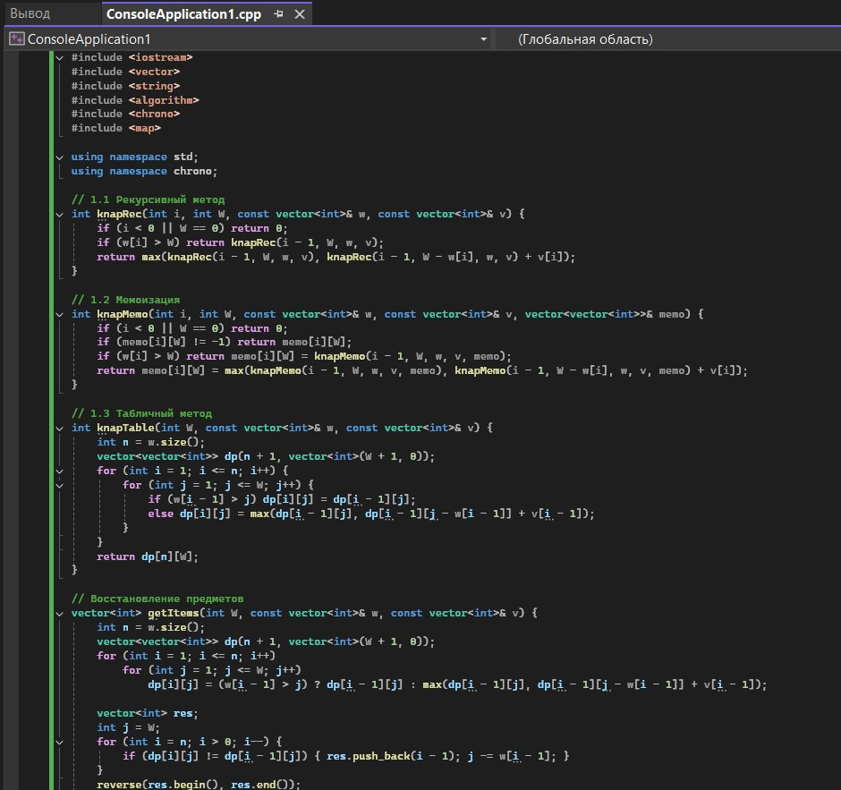
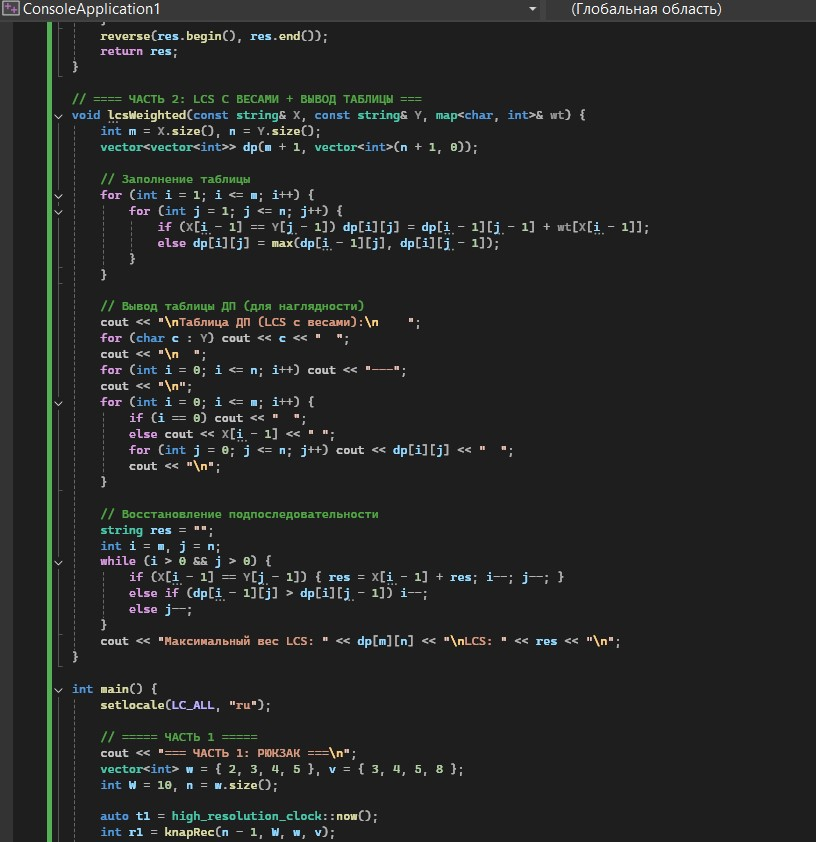
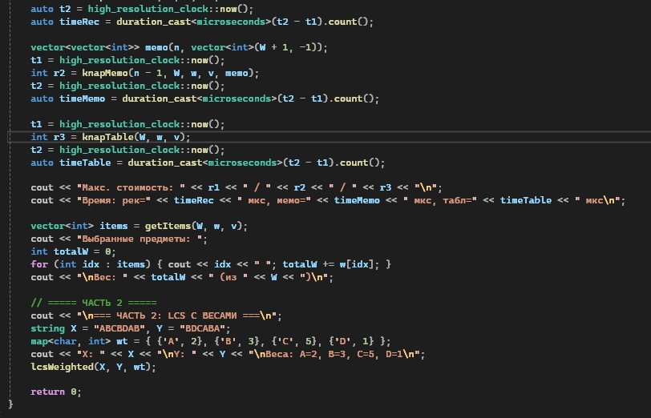
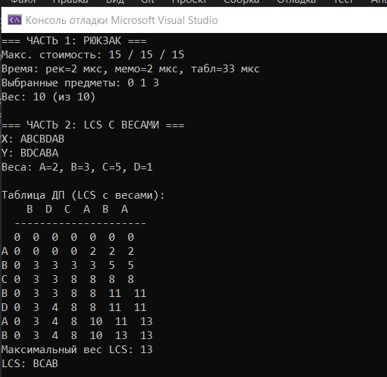

# Лабораторная работа №14

**Тема:** Динамическое программирование. Задача о рюкзаке. Наибольшая общая подпоследовательность (LCS)  
**Дисциплина:** Алгоритмы и структуры данных  
**Вариант:** 9

**Выполнила:** Студент группы ПИЖ-б-о-25-1, направление подготовки: 09.03.04 «Программная инженерия» Калмазова Серафима Владимировна  
**Проверила:** ассистент кафедры программной инженерии Белик Ангелина Игоревна

*Ставрополь 2026*

---

## Цель работы

1. Изучить основные принципы динамического программирования: оптимальная подструктура, перекрывающиеся подзадачи, мемоизация.
2. Реализовать классическую задачу о рюкзаке (0/1) с использованием табличного метода ДП.
3. Реализовать алгоритм поиска наибольшей общей подпоследовательности (LCS) для двух строк.
4. Научиться восстанавливать решение (какие предметы выбраны, какая подпоследовательность).
5. Сравнить рекурсивный подход с мемоизацией и итеративный подход.

---

## Теоретическая часть

### 1. Динамическое программирование

**Динамическое программирование (ДП)** – это метод решения задач, который разбивает сложную задачу на более простые подзадачи, решает каждую подзадачу один раз и сохраняет результат для последующего использования.

**Основные принципы ДП:**
1. **Оптимальная подструктура** – оптимальное решение задачи содержит оптимальные решения подзадач.
2. **Перекрывающиеся подзадачи** – одни и те же подзадачи решаются многократно.
3. **Мемоизация** – сохранение результатов подзадач в таблице для избежания повторных вычислений.

**Способы реализации ДП:**
* Рекурсия + мемоизация (top-down, сверху вниз).
* Табличный метод (bottom-up, снизу вверх).

### 2. Задача о рюкзаке (0/1 Knapsack)

Дано N предметов, каждый предмет имеет вес `weight[i]` и стоимость `value[i]`. Дан рюкзак вместимостью W. Нужно выбрать предметы так, чтобы их суммарный вес не превышал W, а суммарная стоимость была максимальной. Каждый предмет можно взять только один раз (0/1).

### 3. Наибольшая общая подпоследовательность (LCS)

Даны две строки. Нужно найти их наибольшую общую подпоследовательность (символы не обязательно идут подряд). Например, для строк "ABCBDAB" и "BDCABA" LCS равна "BCBA" (длина 4).

---

## Ход выполнения лабораторной работы

**Ссылка на Git-репозиторий:** [https://github.com/serafima2007k-code/algoritms.git](https://github.com/serafima2007k-code/algoritms.git)

**Индивидуальные задания (Вариант 9):**

**Часть 1. Задача о рюкзаке:**
* Размерность – Все три подхода (рекурсия, мемоизация, табличный).
* Особенности – Сравнение производительности.

**Часть 2. Наибольшая общая подпоследовательность (LCS):**
* Особенности – Табличный метод.
* Дополнительное задание – LCS с весами символов.

**Часть 3. Применение ДП:**
1. Реализовать программу, которая запрашивает у пользователя данные для рюкзака (количество предметов, вместимость, вес и ценность каждого предмета) и две строки для LCS.
2. Вычисляет оптимальное решение.
3. Выводит результат (максимальную стоимость и выбранные предметы / длину LCS и саму подпоследовательность).
4. Выводит таблицу ДП для наглядности.

**Пример входных данных для рюкзака:** Количество предметов: 4, Вместимость: 10, Предмет 0: вес=2, ценность=3, Предмет 1: вес=3, ценность=4, Предмет 2: вес=4, ценность=5, Предмет 3: вес=5, ценность=8.  
**Пример входных данных для LCS:** Строка X: "ABCBDAB", Строка Y: "BDCABA".

### Листинг программы

*Рисунок 1 – Код программы*

*Рисунок 2 – Код программы (продолжение)*

*Рисунок 3 – Код программы (продолжение)*

### Результат работы программы

*Рисунок 4 – Результат работы программы*

---

## Анализ сложности
* Задача о рюкзаке:
* Рекурсивный метод (без мемоизации): Время O(2ⁿ), память O(n) – стек вызовов.
* Рекурсия с мемоизацией: Время O(n * W), память O(n * W) – таблица.
* Табличный метод: Время O(n * W), память O(n * W) – таблица.
* LCS (табличный метод):
* Время O(m * n), память O(m * n), где m и n – длины строк.

## Сравнительная таблица подходов:

|Метод|	Время	|Память|
| :--- | :--- |:--- |
|Рекурсивный (Knapsack)|	O(2ⁿ)	|O(n)|
|Мемоизация (Knapsack)	|O(n*W)|	O(n*W)|
|Табличный (Knapsack)	|O(n*W)	|O(n*W)|
|LCS (табличный)	|O(m*n)	|O(m*n)|

## Контрольные вопросы
1. Что такое динамическое программирование? Какие принципы лежат в его основе?
Динамическое программирование — это метод решения задач, который разбивает сложную задачу на более простые подзадачи, решает каждую подзадачу один раз и сохраняет результат для повторного использования. Основные принципы: оптимальная подструктура (оптимальное решение задачи содержит оптимальные решения подзадач) и перекрывающиеся подзадачи (одни и те же подзадачи решаются многократно).

2. В чём разница между рекурсивным подходом с мемоизацией (top-down) и табличным (bottom-up)?
Рекурсивный с мемоизацией идёт от исходной задачи к базовым случаям (сверху вниз), сохраняя результаты в таблице. Табличный метод идёт от базовых случаев к исходной задаче (снизу вверх), заполняя таблицу итеративно. Табличный метод обычно быстрее, но занимает больше памяти, так как заполняет всю таблицу.

3. Как формулируется задача о рюкзаке (0/1)?
Дано N предметов, каждый предмет имеет вес weight[i] и стоимость value[i]. Есть рюкзак вместимостью W. Нужно выбрать предметы так, чтобы их суммарный вес не превышал W, а суммарная стоимость была максимальной. Каждый предмет можно взять только один раз (0/1).

4. Какова временная сложность решения задачи о рюкзаке методом ДП?
Временная сложность — O(N * W), где N — количество предметов, W — вместимость рюкзака. Табличный метод требует O(N * W) памяти.

5. Почему для оптимизации памяти нужно проходить по весам в обратном порядке?
При использовании одномерного массива (оптимизация памяти) мы проходим по весам от W до weight[i]. Это нужно, чтобы при обновлении dp[w] использовались значения из предыдущей итерации (dp[w - weight[i]]), а не текущей. Если идти в прямом порядке, можно случайно использовать предмет несколько раз (задача о рюкзаке с повторениями).

6. Как восстановить выбранные предметы после заполнения таблицы ДП?
Идём от dp[N][W] вверх по таблице. Если dp[i][w] != dp[i-1][w], значит, предмет i-1 был выбран. Тогда добавляем его в список и уменьшаем w на weight[i-1]. Продолжаем, пока i > 0.

7. Как формулируется задача LCS?
Даны две строки X и Y. Нужно найти их наибольшую общую подпоследовательность (символы не обязательно идут подряд). Например, для "ABCBDAB" и "BDCABA" LCS равна "BCBA" (длина 4).

8. Какова временная сложность алгоритма LCS?
Время O(m * n), где m и n — длины строк X и Y. Память O(m * n) для таблицы.

9. В чём разница между подпоследовательностью и подстрокой?
Подпоследовательность — это символы, идущие в том же порядке, но не обязательно подряд (могут быть пропуски). Подстрока — это непрерывный фрагмент строки. Например, для "ABCBDAB" подпоследовательность "BCBA" является LCS с "BDCABA", но это не подстрока.

10. Как восстановить LCS после заполнения таблицы?
Идём от dp[m][n] вверх по таблице. Если X[i-1] == Y[j-1], значит, символ входит в LCS. Добавляем его в результат и идём по диагонали (i--, j--). Иначе идём в сторону большего значения: если dp[i-1][j] > dp[i][j-1], идём вверх (i--), иначе влево (j--).

11. Какие ещё задачи решаются с помощью ДП?
Задача о рюкзаке, LCS, задача о наибольшей возрастающей подпоследовательности (LIS), задача о разбиении строки, задача о расстоянии Левенштейна (редакционное расстояние), задача о матричном умножении, задача о монетах (размен), задача коммивояжёра (для малых N).

12. В чём отличие задачи о рюкзаке от задачи о рюкзаке с повторениями?
В задаче 0/1 каждый предмет можно взять только один раз. В задаче с повторениями (unbounded knapsack) каждый предмет можно брать неограниченное количество раз. Для решения задачи с повторениями при оптимизации памяти проходят по весам в прямом порядке (от weight[i] до W).

13. Можно ли решить LCS за меньшее время, чем O(m×n)?
Для общего случая — нет, так как нужно сравнить все пары символов. Однако существуют оптимизации для специальных случаев (например, когда строки почти одинаковые). Также можно использовать битовые операции (алгоритм Ханта-Шиманского) для ускорения на практике.

14. Как адаптировать ДП для LCS трёх строк?
Нужно использовать трёхмерную таблицу dp[i][j][k], где i, j, k — длины префиксов трёх строк. Рекуррентная формула: если символы совпадают, dp[i][j][k] = dp[i-1][j-1][k-1] + 1, иначе max из трёх вариантов (уменьшение одной из строк). Время O(m * n * k).

15. Как модифицировать задачу о рюкзаке для случая, когда предмет можно взять несколько раз?
При табличном методе нужно изменить порядок обхода: для каждого предмета проходить по весам в прямом порядке (от weight[i] до W). Тогда dp[w] будет обновляться с использованием уже обновлённых значений, что позволит брать предмет многократно.

## Вывод
* Изучила основные принципы динамического программирования: оптимальная подструктура, перекрывающиеся подзадачи, мемоизация.
* Реализовала классическую задачу о рюкзаке (0/1) с использованием табличного метода ДП.
* Реализовала алгоритм поиска наибольшей общей подпоследовательности (LCS) для двух строк.
* Научилась восстанавливать решение (какие предметы выбраны, какая подпоследовательность).
* Сравнила рекурсивный подход с мемоизацией и итеративный подход.

