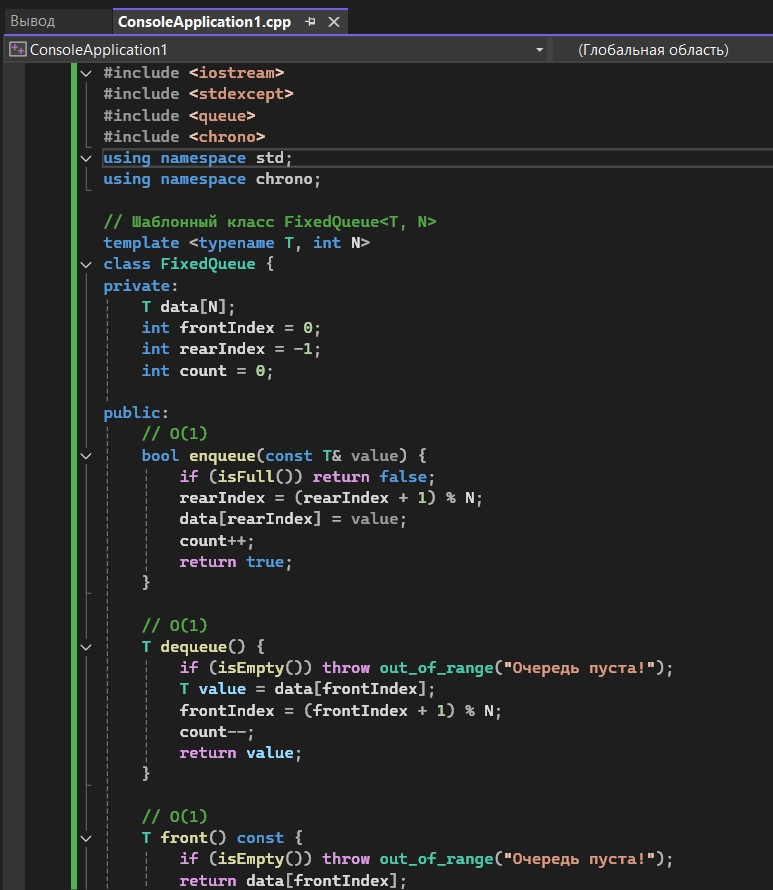
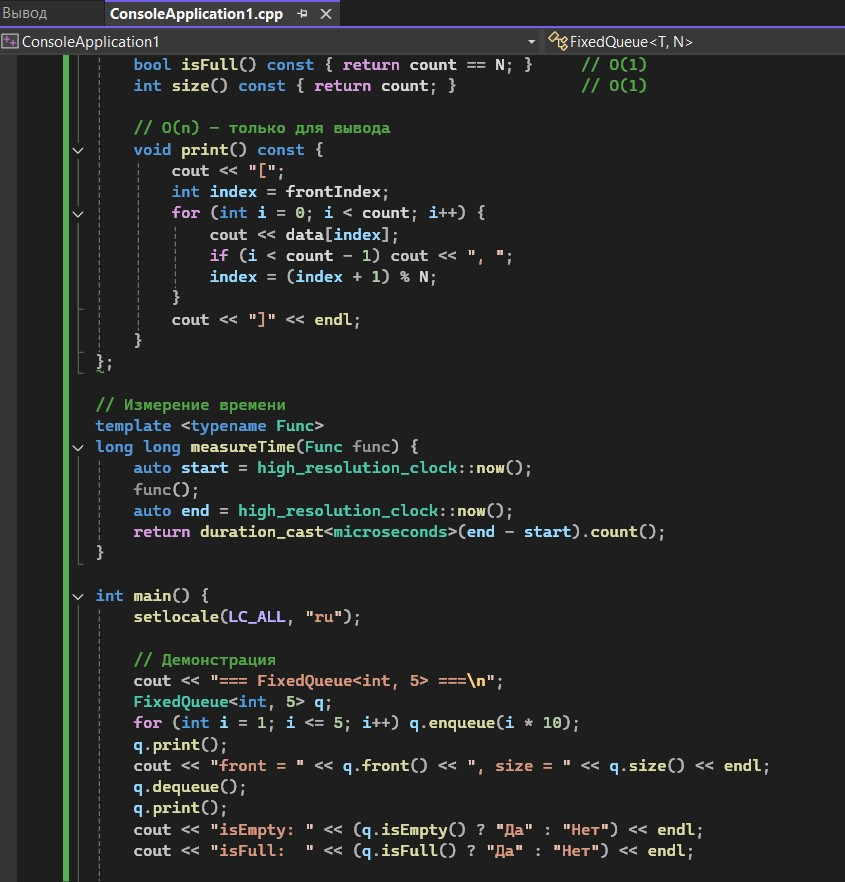
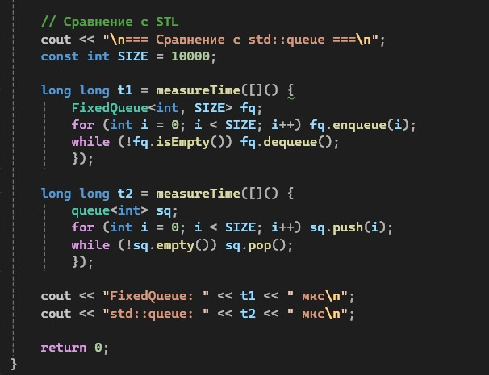
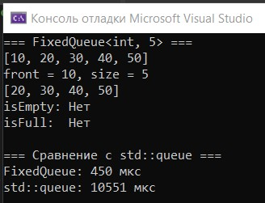

# Лабораторная работа №2

**Тема:** Анализ сложности алгоритмов. Шаблоны классов  
**Дисциплина:** Алгоритмы и структуры данных  
**Вариант:** 14

**Выполнила:** Студент группы ПИЖ-б-о-25-1, направление подготовки: 09.03.04 «Программная инженерия» Калмазова Серафима Владимировна  
**Проверила:** ассистент кафедры программной инженерии Белик Ангелина Игоревна

*Ставрополь 2026*

---

## Цель работы

1. Научиться оценивать эффективность алгоритмов с помощью О-нотации (Big O).
2. Освоить классы сложности: O(1), O(log n), O(n), O(n log n), O(n²).
3. Научиться проводить экспериментальный анализ производительности алгоритмов.
4. Освоить создание шаблонов функций и классов для работы с различными типами данных.
5. Получить навыки сравнения производительности различных реализаций одной задачи.

---

## Теоретическая часть

О-нотация – это способ описать, как быстро растёт время работы программы при увеличении количества данных.

**Аналогия:** Представь, что ты ищешь книгу в библиотеке.
* Если книги стоят по алфавиту – ты быстро найдёшь (O(log n)).
* Если книги в куче – придётся просмотреть все (O(n)).
* Если ты сравниваешь каждую книгу с каждой – очень долго (O(n²)).

**Основные классы сложности:**

| Сложность | Название | Когда бывает |
|-----------|----------|--------------|
| **O(1)** | Константная | Доступ к элементу массива по индексу |
| **O(log n)** | Логарифмическая | Бинарный поиск (делим пополам) |
| **O(n)** | Линейная | Один проход по массиву |
| **O(n log n)** | Линейно-логарифмическая | Хорошие сортировки |
| **O(n²)** | Квадратичная | Два вложенных цикла |

**Как определить сложность по коду:**
1. Один цикл → O(n).
2. Два вложенных цикла → O(n²).
3. Деление пополам → O(log n).
4. Без циклов → O(1).

---

## Ход выполнения лабораторной работы

**Ссылка на Git-репозиторий:** https://github.com/serafima2007k-code/algoritms.git

**Продвинутый уровень (Вариант 14)**
**Общее задание:** Реализовать шаблонный контейнер с заданной функциональностью. Провести анализ сложности каждой операции. Экспериментально сравнить производительность с аналогом из STL.

*   **Контейнер:** FixedQueue
*   **Требования:** enqueue, dequeue, front, isEmpty, isFull

### Листинг программы

*Рисунок 1 – Код программы (шаблонный класс)*

*Рисунок 2 – Код программы (продолжение)*

*Рисунок 3 – Код программы (продолжение)*

### Результат работы программы

*Рисунок 4 – Результат работы программы*

---

## Анализ сложности всех операций

| Операция | Сложность | Почему |
|----------|-----------|--------|
| **enqueue** | O(1) | Одно присваивание, один сдвиг индекса |
| **dequeue** | O(1) | Одно чтение, один сдвиг индекса |
| **front** | O(1) | Одно обращение к массиву |
| **isEmpty** | O(1) | Одно сравнение |
| **isFull** | O(1) | Одно сравнение |
| **print** | O(n) | Проход по всем элементам |

---

## Контрольные вопросы

**1. Что такое О-нотация (Big O) и зачем она нужна?**  
О-нотация – это математический способ описать, как быстро растёт время работы алгоритма при увеличении входных данных; нужна, чтобы сравнивать алгоритмы и выбирать самый эффективный.

**2. Какая сложность у доступа к элементу массива по индексу? Почему?**  
O(1). Потому что адрес элемента вычисляется по формуле: адрес_начала + индекс × размер_элемента. Это одна операция, не зависящая от размера массива.

**3. Какая сложность у бинарного поиска? Почему?**  
O(log n). Потому что на каждом шаге мы делим массив пополам. Количество шагов = log₂(n).

**4. Что означает сложность O(n log n)? Приведите пример алгоритма.**  
Это означает, что время работы растёт как n × log(n). Пример: быстрая сортировка (quick sort), сортировка слиянием (merge sort).

**5. Что такое амортизированный анализ? Приведите пример.**  
Амортизированный анализ – это усреднение сложности по многим операциям. Пример: push в стек с расширением. Одна операция может быть O(n) (при расширении), но в среднем – O(1).

**6. Какая сложность у двух вложенных циклов по n итераций каждый?**  
O(n²) – квадратичная.

**7. Какая сложность у рекурсивного вычисления чисел Фибоначчи?**  
O(2ⁿ) – экспоненциальная, потому что каждый вызов порождает два новых.

**8. Что такое шаблоны функций? Как их объявить и использовать?**  
Шаблон функции – это «заготовка», которая может работать с разными типами. Объявление: `template <typename T> T func(T a, T b)`. Использование: `func(5, 10)` или `func<double>(1.5, 2.5)`.

**9. Что такое шаблоны классов? Как их объявить и использовать?**  
Шаблон класса – это класс, который может хранить данные любого типа. Объявление: `template <typename T> class MyClass { T data; };`. Использование: `MyClass<int> obj;`

**10. В чём преимущество шаблонов перед перегрузкой функций?**  
Шаблон пишется один раз для всех типов, а перегрузку нужно писать для каждого типа отдельно; меньше кода, меньше ошибок.

**11. Как указать, что шаблонный параметр – тип?**  
С помощью ключевого слова `typename` или `class`: `template <typename T>` или `template <class T>`.

**12. Можно ли создать шаблон с несколькими параметрами типов?**  
Да: `template <typename T1, typename T2> class Pair { T1 first; T2 second; };`

**13. Как провести экспериментальное измерение времени выполнения?**  
С помощью `chrono`: засечь время до и после, вычислить разницу.

**14. Почему при измерении времени нужно выполнять операцию многократно?**  
Потому что одна операция может быть слишком быстрой (наносекунды), и точность измерения низкая. Многократное повторение усредняет результат.

**15. Что важнее: сложность алгоритма или константа?**  
Для больших данных важнее сложность (O(n) всегда лучше O(n²) при больших n). Для маленьких данных константа может играть роль. Но в целом – сложность важнее.

---

## Вывод

1. Научилась оценивать эффективность алгоритмов с помощью О-нотации (Big O).
2. Освоила классы сложности: O(1), O(log n), O(n), O(n log n), O(n²).
3. Научилась проводить экспериментальный анализ производительности алгоритмов.
4. Освоила создание шаблонов функций и классов для работы с различными типами данных.
5. Получила навыки сравнения производительности различных реализаций одной задачи.
