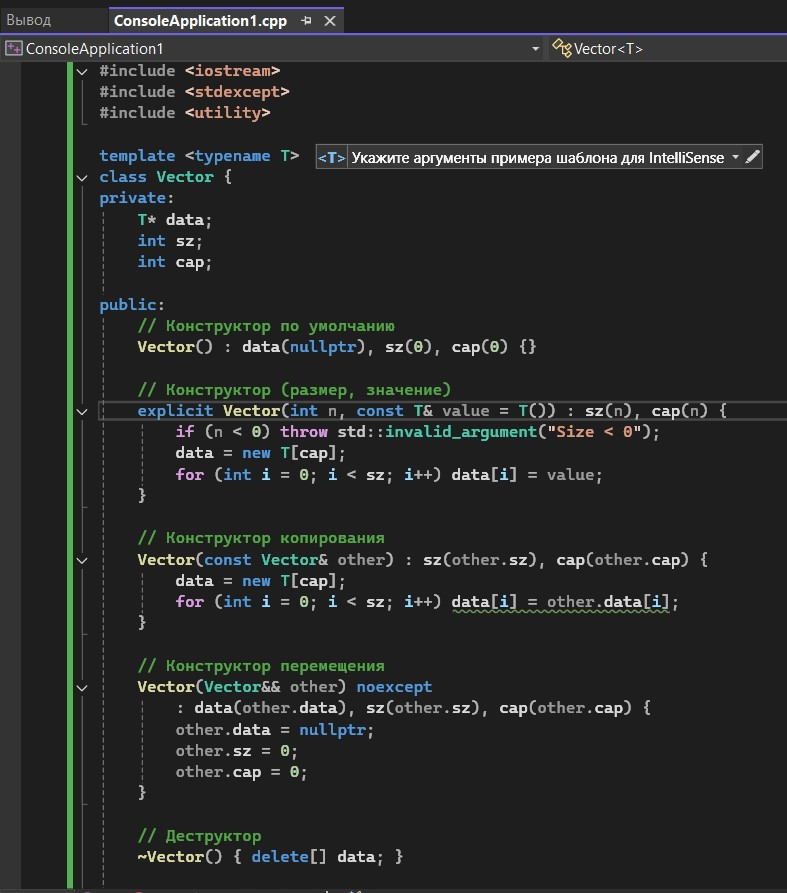
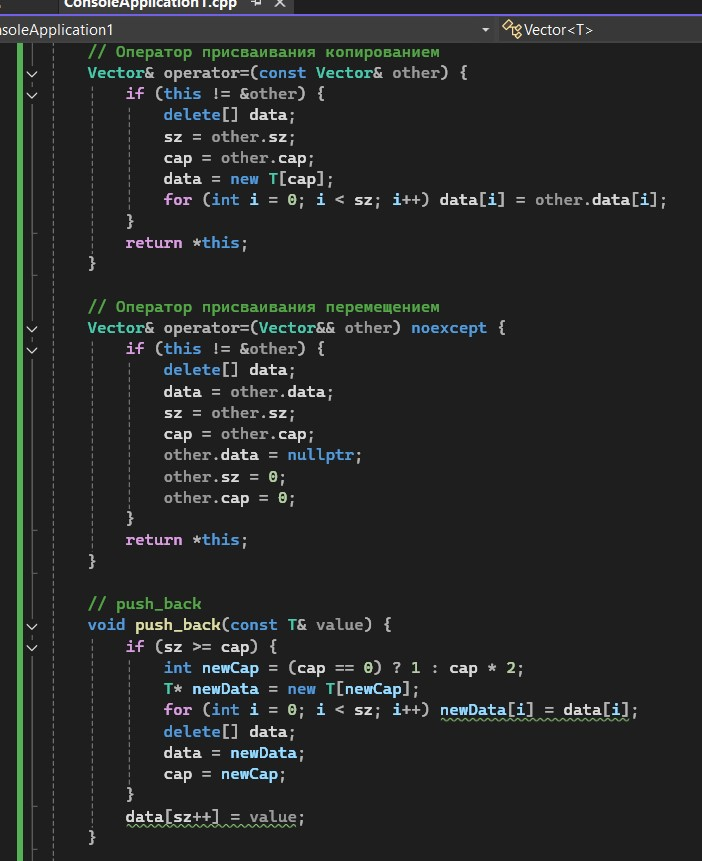
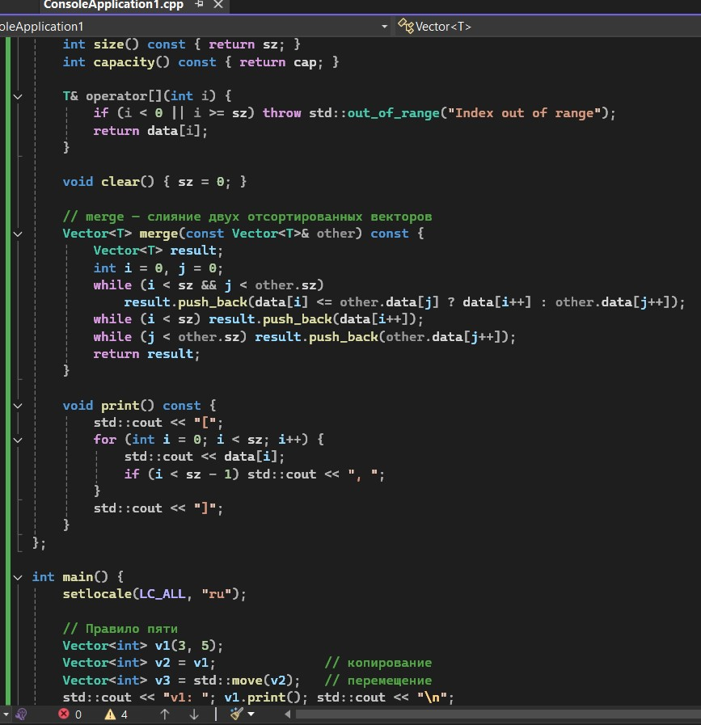
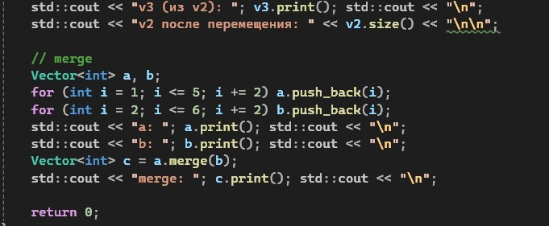
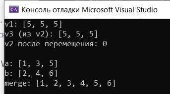

# Лабораторная работа №3

**Тема:** Реализация динамического массива (аналог vector). Итераторы  
**Дисциплина:** Алгоритмы и структуры данных  
**Вариант:** 14

**Выполнила:** Студент группы ПИЖ-б-о-25-1, направление подготовки: 09.03.04 «Программная инженерия» Калмазова Серафима Владимировна  
**Проверила:** ассистент кафедры программной инженерии Белик Ангелина Игоревна

*Ставрополь 2026*

---

## Цель работы

1. Реализовать шаблонный класс `Vector` — аналог `std::vector` — с нуля.
2. Освоить управление динамической памятью: выделение, расширение, освобождение.
3. Закрепить «правило трёх» (деструктор, конструктор копирования, оператор присваивания) и освоить «правило пяти» (конструктор и оператор перемещения).
4. Реализовать итераторы для поддержки range-based for и STL-совместимости.
5. Провести амортизированный анализ операции `push_back`.

---

## Амортизированный анализ `push_back`

Суммарное количество копирований за n вставок ≈ 2n. То есть амортизированно **O(1)** на одну операцию.

| Действие | Количество копирований |
| :--- | :--- |
| Вставка 1 | 0 |
| Вставка 2 (расширение 1-2) | 1 |
| Вставка 3 | 0 |
| Вставка 4 (расширение 2-4) | 2 |
| Вставки 5-7 | 0 |
| Вставка 8 (расширение 4-8) | 4 |

---

## Ход выполнения лабораторной работы

**Средний уровень (Вариант 14)**
**Общее задание:** Реализовать класс `Vector` с полной поддержкой «правила пяти» и дополнительной функциональностью согласно варианту.

*   **Дополнительная функциональность:** Метод `merge` — слияние двух отсортированных векторов.

### Листинг программы

*Рисунок 1 – Код программы*

*Рисунок 2 – Код программы (продолжение)*

*Рисунок 3 – Код программы (продолжение)*

*Рисунок 4 – Код программы (продолжение)*

### Результат работы программы

*Рисунок 5 – Результат работы программы*

---

## Анализ сложности всех операций

| Операция | Сложность |
| :--- | :--- |
| Конструктор по умолчанию | O(1) |
| Конструктор (размер, значение) | O(n) |
| Конструктор копирования | O(n) |
| Конструктор перемещения | O(1) |
| Деструктор | O(1) |
| Оператор = копированием | O(n) |
| Оператор = перемещением | O(1) |
| `push_back` | O(1) амортизированно |
| `size`, `capacity` | O(1) |
| `operator[]` | O(1) |
| `clear` | O(1) |
| `merge` | O(n + m) |
| `print` | O(n) |

---

## Контрольные вопросы

**1. Почему динамический массив называется «динамическим»?**  
Потому что его размер может изменяться во время выполнения программы (выделяется в куче, а не на стеке).

**2. Что такое ёмкость (capacity) и чем она отличается от размера (size)?**  
`size` – количество реально хранимых элементов. `capacity` – сколько элементов может поместиться в выделенной памяти без перевыделения. Всегда `capacity >= size`.

**3. Почему при расширении массива ёмкость удваивается, а не увеличивается на фиксированное число?**  
Удвоение обеспечивает амортизированную сложность O(1) для `push_back`. При добавлении фиксированного числа (например, +10) количество перевыделений растёт линейно, и общая сложность становится O(n²).

**4. Какова амортизированная сложность операции `push_back`? Почему?**  
O(1). При удвоении ёмкости суммарное количество копирований за n операций равно 1+2+4+...+n ≈ 2n, то есть в среднем O(1) на операцию.

**5. Что такое «правило трёх»? Когда оно применяется?**  
Если класс управляет ресурсами (динамическая память), нужно определить три метода: деструктор, конструктор копирования, оператор присваивания копированием. Применяется для избежания утечек и двойного освобождения.

**6. Что такое «правило пяти»? Чем оно отличается от «правила трёх»?**  
Добавляются ещё конструктор перемещения и оператор присваивания перемещением. Это позволяет эффективно перемещать ресурсы вместо копирования.

**7. В чём разница между конструктором копирования и оператором присваивания?**  
Конструктор копирования создаёт новый объект на основе существующего. Оператор присваивания изменяет уже существующий объект.

**8. Зачем нужна проверка `if (this != &other)` в операторе присваивания?**  
Чтобы избежать самоприсваивания (`a = a`), которое может привести к удалению собственных данных перед копированием.

**9. Что такое итератор? Как он связан с указателем?**  
Итератор – объект, позволяющий перебирать элементы контейнера. В простейшем случае (для массива) итератор – это указатель на элемент.

**10. Зачем нужны методы `begin()` и `end()`?**  
Для организации цикла по элементам контейнера (в том числе range-based for). `begin()` указывает на первый элемент, `end()` – на позицию после последнего.

**11. Как реализовать range-based for для своего контейнера?**  
Нужно определить методы `begin()` и `end()`, возвращающие итераторы (или указатели).

**12. Что такое «глубокое копирование»? Чем оно отличается от «поверхностного»?**  
Глубокое копирование создаёт независимую копию данных (выделяет новую память). Поверхностное копирует только указатели, что ведёт к разделению ресурсов и проблемам при освобождении.

**13. Что такое семантика перемещения и зачем она нужна?**  
Это передача ресурсов от одного объекта другому без копирования. Позволяет избежать дорогостоящего копирования временных объектов.

**14. Почему конструктор перемещения помечается `noexcept`?**  
Чтобы стандартные контейнеры могли использовать перемещение вместо копирования при исключениях, обеспечивая строгую гарантию безопасности.

**15. Как правильно освобождать память в деструкторе?**  
Использовать `delete[]` для памяти, выделенной через `new[]`, и только один раз.

---

## Вывод

* Реализовала шаблонный класс `Vector` — аналог `std::vector` — с нуля.
* Освоила управление динамической памятью: выделение, расширение, освобождение.
* Закрепила «правило трёх» (деструктор, конструктор копирования, оператор присваивания) и освоила «правило пяти» (конструктор и оператор перемещения).
* Реализовала итераторы для поддержки range-based for и STL-совместимости.
* Провела амортизированный анализ операции `push_back`.
