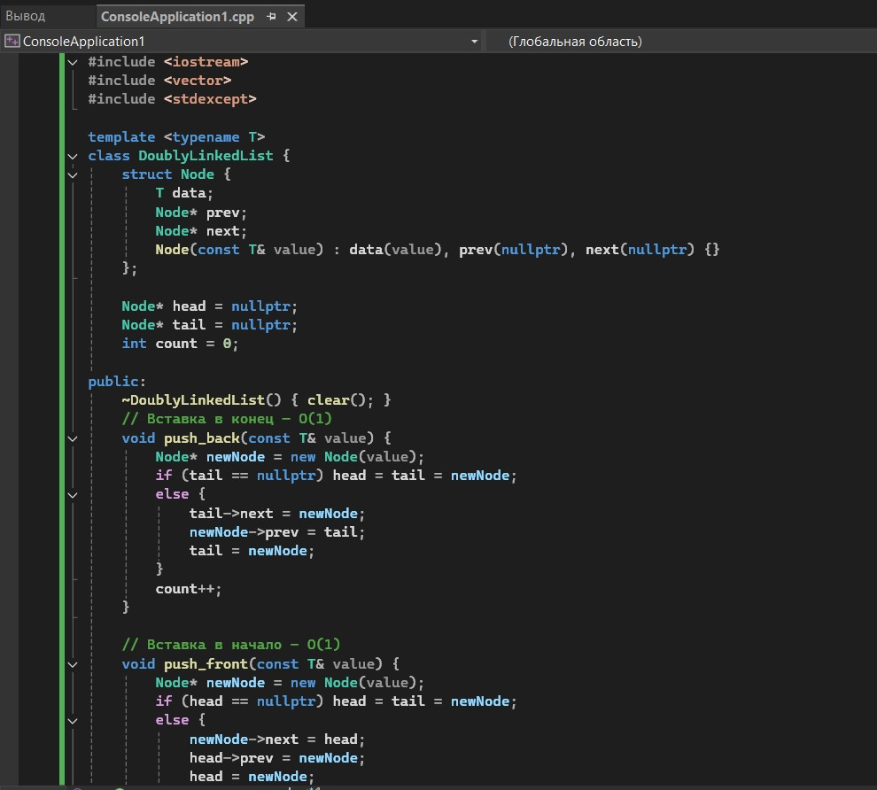
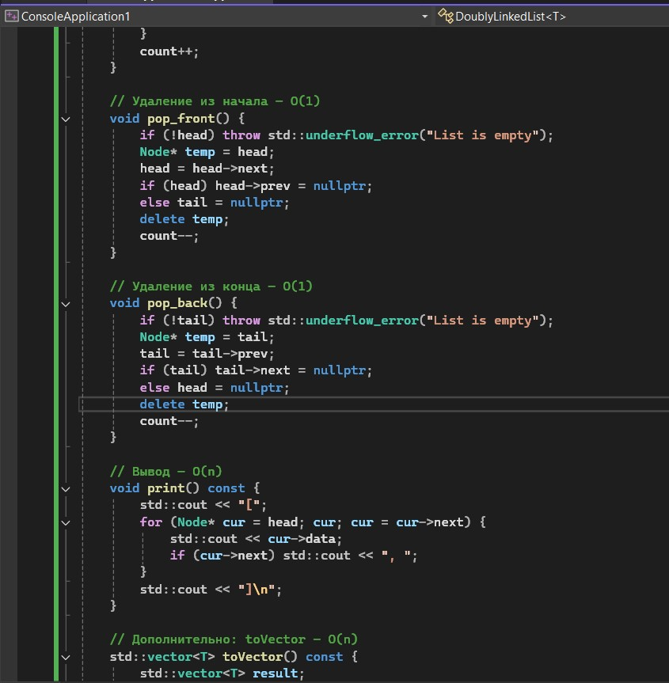
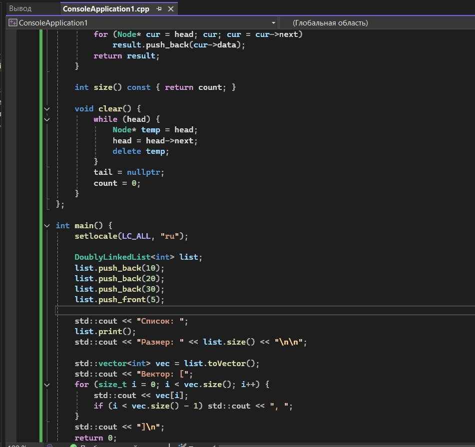
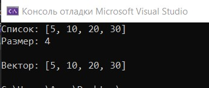

# Лабораторная работа №4

**Тема:** Односвязный и двусвязный списки  
**Дисциплина:** Алгоритмы и структуры данных  
**Вариант:** 14

**Выполнила:** Студент группы ПИЖ-б-о-25-1, направление подготовки: 09.03.04 «Программная инженерия» Калмазова Серафима Владимировна  
**Проверила:** ассистент кафедры программной инженерии Белик Ангелина Игоревна

*Ставрополь 2026*

---

## Цель работы

1. Реализовать шаблонный класс односвязного списка (SinglyLinkedList) с базовыми операциями.
2. Реализовать шаблонный класс двусвязного списка (DoublyLinkedList) с базовыми операциями.
3. Освоить операции вставки, удаления, поиска и обхода элементов в списках.
4. Сравнить производительность и особенности использования односвязного и двусвязного списков.
5. Научиться правильно управлять памятью при работе со списками (удаление узлов).

---

## Теоретическая часть

**Связный список** – это структура данных, в которой элементы (узлы) хранятся в памяти не непрерывно. Каждый узел содержит данные и указатель(и) на следующий (и/или предыдущий) узел.

**Виды связных списков:**
*   **Односвязный** – каждый узел знает только следующий узел.
*   **Двусвязный** – каждый узел знает следующий и предыдущий.

**Визуализация:**

```text
Односвязный:
head → [10] → [20] → [30] → nullptr

Двусвязный:
head ⇄ [10] ⇄ [20] ⇄ [30] ⇄ nullptr
```

Преимущества связного списка:
Вставка/удаление в начале – O(1) (не нужно сдвигать элементы).
Размер не ограничен заранее (растёт по мере добавления).

Недостатки:
Доступ по индексу – O(n) (нужно идти от head до нужного узла).
Каждый узел занимает больше памяти (данные + указатели).

**Узел (Node) – это элемент списка, который хранит данные и указатель(и) на соседние узлы.**

Узел односвязного списка:
```cpp
template <typename T>
struct Node {
    T data;          // данные (любого типа)
    Node<T>* next;   // указатель на следующий узел
    
    Node(const T& value) : data(value), next(nullptr) {}
};
```
Разбор полей: T data – сами данные (int, double, string...). Node<T>* next – адрес следующего узла. Если nullptr – это конец списка.

Узел двусвязного списка:
```cpp
template <typename T>
struct DNode {
    T data;          // данные
    DNode<T>* prev;  // указатель на предыдущий узел
    DNode<T>* next;  // указатель на следующий узел
    
    DNode(const T& value) : data(value), prev(nullptr), next(nullptr) {}
};
```
Разница: Есть prev – можно идти назад. Аналогия: Вагон с грузом и двумя сцепками (вперёд и назад).

**Head (голова)** – указатель на первый узел списка. С него начинается любой обход списка. Если head == nullptr – список пуст.
**Tail (хвост)** – указатель на последний узел списка. Позволяет вставлять в конец за O(1) (без обхода всего списка). В двусвязном списке позволяет удалять из конца за O(1).

## Ход выполнения лабораторной работы
Ссылка на Git-репозиторий: https://github.com/serafima2007k-code/algoritms.git

**Средний уровень (Вариант 14)**
**Общее задание**:
Реализовать класс двусвязного списка с указанными методами и дополнительной функциональностью.

Дополнительная функциональность: Метод toVector() — преобразование в std::vector.

### Листинг программы



*Рисунок 1 – Код программы*



*Рисунок 2 – Код программы (продолжение)*



*Рисунок 3 – Код программы (продолжение)*

### Результат работы программы



*Рисунок 4 – Результат работы программы*

---

## Анализ сложности всех операций

| Операция | Сложность | Пояснение |
| :--- | :--- | :--- |
| **Конструктор** | O(1) | Просто обнуляем поля: `head = tail = nullptr`, `count = 0` |
| **Деструктор** | O(n) | Вызывает `clear()`, который удаляет все узлы |
| **push_back** | O(1) | Благодаря `tail` — добавляем в конец за одно действие |
| **push_front** | O(1) | Добавляем в начало: переставляем `head` за одно действие |
| **print** | O(n) | Проходим по всем n узлам от `head` до конца |
| **toVector** | O(n) | Проходим по всем n узлам и копируем данные |
| **size** | O(1) | Возвращаем готовое поле `count` |
| **empty** | O(1) | Сравнение `head == nullptr` |
| **clear** | O(n) | Удаляем все n узлов |

---

## Контрольные вопросы

**1. Чем связный список отличается от динамического массива?**  
Список хранит элементы не непрерывно, а через указатели, массив – непрерывно.

**2. Какие операции в односвязном списке выполняются за O(1)?**  
`push_front`, `pop_front` (если есть `head`), `push_back` (если есть `tail`).

**3. Почему удаление из конца односвязного списка требует O(n)?**  
Нужно дойти до предпоследнего узла, а для этого пройти весь список.

**4. Какие преимущества даёт хранение указателя tail?**  
Позволяет делать `push_back` за O(1).

**5. Чем двусвязный список отличается от односвязного?**  
Есть указатель `prev` – можно идти назад и удалять из конца за O(1).

**6. Какие операции в двусвязном списке быстрее?**  
`pop_back`, `erase`, `insert_after` – все за O(1).

**7. Что такое head и tail?**  
`head` – первый узел, `tail` – последний.

**8. Как удалить узел из середины односвязного списка?**  
Найти предыдущий узел, переставить указатель, удалить.

**9. Как удалить узел из середины двусвязного списка?**  
Есть `prev` и `next` – просто переставляем указатели.

**10. Что будет, если забыть обновить tail при удалении?**  
`tail` будет указывать на удалённый узел → ошибка при следующем использовании.

**11. Как реализовать реверс односвязного списка?**  
Идти по списку, меняя указатели `next` на предыдущий.

**12. Как обнаружить цикл?**  
Алгоритм Флойда (черепаха и заяц): два указателя с разной скоростью.

**13. Когда стоит использовать список вместо массива?**  
Когда часто вставляем/удаляем в начале или середине, а доступ по индексу не нужен.

**14. Какая дополнительная память на узел?**  
Односвязный: 1 указатель. Двусвязный: 2 указателя.

**15. Почему доступ по индексу в списке O(n)?**  
Нужно пройти от `head` до нужного узла.

---

## Вывод

* Реализовала шаблонный класс односвязного списка (SinglyLinkedList) с базовыми операциями.
* Реализовала шаблонный класс двусвязного списка (DoublyLinkedList) с базовыми операциями.
* Освоила операции вставки, удаления, поиска и обхода элементов в списках.
* Сравнила производительность и особенности использования односвязного и двусвязного списков.
* Научилась правильно управлять памятью при работе со списками (удаление узлов).
