# Лабораторная работа №5

**Тема:** Стек, очередь, дек, приоритетная очередь  
**Дисциплина:** Алгоритмы и структуры данных  
**Вариант:** 14

**Выполнила:** Студент группы ПИЖ-б-о-25-1, направление подготовки: 09.03.04 «Программная инженерия» Калмазова Серафима Владимировна  
**Проверила:** ассистент кафедры программной инженерии Белик Ангелина Игоревна

*Ставрополь 2026*

---

## Цель работы

1. Реализовать основные линейные структуры данных: стек, очередь, дек и приоритетную очередь.
2. Освоить принципы LIFO (стек) и FIFO (очередь).
3. Научиться реализовывать эти структуры на основе динамического массива и связного списка.
4. Изучить применение стека для решения задач (проверка скобок, обратная польская запись).
5. Реализовать приоритетную очередь на основе кучи (heap).

---

## Теоретическая часть

### 1. Стек (Stack)
**Определение:** Стек – это структура данных, работающая по принципу **LIFO** (Last In – First Out, «последним пришёл – первым вышел»).  
**Аналогия:** Стопка тарелок – кладём сверху, берём сверху.

| Операция | Описание | Сложность |
| :--- | :--- | :--- |
| `push(value)` | Добавляет элемент на вершину | O(1) |
| `pop()` | Удаляет и возвращает верхний элемент | O(1) |
| `top()` | Возвращает верхний элемент без удаления | O(1) |
| `isEmpty()` | Проверяет, пуст ли стек | O(1) |
| `size()` | Возвращает количество элементов | O(1) |

**Визуализация:**
```text
push(1): [1]
push(2): [1, 2]
push(3): [1, 2, 3]
pop():   [1, 2] (возвращает 3)
top():   [1, 2] (возвращает 2, не удаляя)
```

**2. Очередь (Queue)**
Определение: Очередь – это структура данных, работающая по принципу FIFO (First In – First Out, «первым пришёл – первым ушёл»).
Аналогия: Обычная очередь в магазине – первый в очереди обслуживается первым.

|Операция	|Описание	|Сложность|
| :--- | :--- | :--- |
|enqueue(value)|	Добавляет элемент в конец	|O(1)|
|dequeue()	|Удаляет и возвращает элемент из начала	|O(1)|
|front()	|Возвращает элемент из начала без удаления	|O(1)|
|isEmpty()	|Проверяет, пуста ли очередь|	O(1)|
|size()	|Возвращает количество элементов	|O(1)|

Визуализация:

```text
enqueue(1): [1]
enqueue(2): [1, 2]
enqueue(3): [1, 2, 3]
dequeue():  [2, 3] (возвращает 1)
front():    [2, 3] (возвращает 2, не удаляя)
```

**3. Дек (Deque)**

Определение: Дек – это структура данных, позволяющая добавлять и удалять элементы с обоих концов.

|Операция|	Описание|	Сложность|
| :--- | :--- | :--- |
|push_front(value)|	Добавляет элемент в начало|	O(1)|
|push_back(value)|	Добавляет элемент в конец	|O(1)|
|pop_front()|	Удаляет элемент из начала	|O(1)|
|pop_back()	|Удаляет элемент из конца|	O(1)|
|front()	|Возвращает первый элемент	|O(1)|
|back()	|Возвращает последний элемент|	O(1)|

**4. Приоритетная очередь (Priority Queue)**
Определение: Приоритетная очередь – это структура данных, в которой каждый элемент имеет приоритет. Элемент с наибольшим приоритетом извлекается первым. Обычно реализуется на основе двоичной кучи (heap).

|Операция	| Описание	|Сложность | 
| :--- | :--- | :--- |
|push(value)	|Добавляет элемент	|O(log n)|
|pop()	|Удаляет элемент с наибольшим приоритетом|	O(log n)|
|top()	|Возвращает элемент с наибольшим приоритетом|	O(1)|

## Ход выполнения лабораторной работы
Ссылка на Git-репозиторий: https://github.com/serafima2007k-code/algoritms.git

**Индивидуальные задания (Вариант 14):**

| Структура	| Задание| 
| :--- | :--- |
| Стек	| Реализовать два стека в одном массиве (экономное использование памяти)| 
| Очередь	| Реализовать очередь с операцией reverse() (разворот)| 
| Дек	| Реализовать дек, который возвращает сумму всех элементов за O(1)| 
| Приоритетная очередь| 	Реализовать приоритетную очередь для пользовательских типов (с компаратором)| 

### Листинг программы

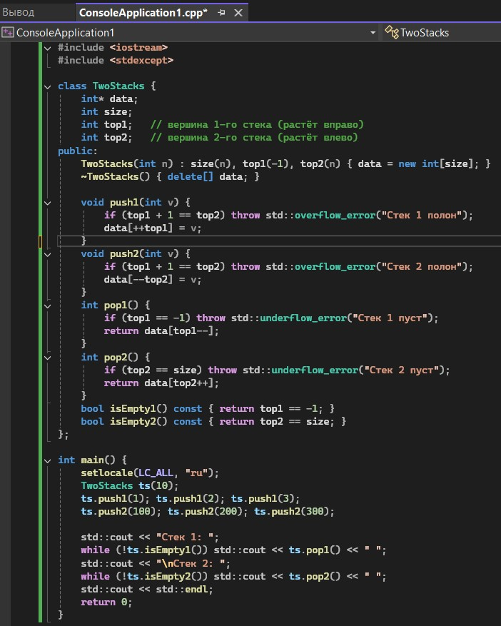

*Рисунок 1 – Код программы*

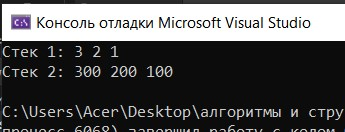


*Рисунок 2 – Результат работы программы1*

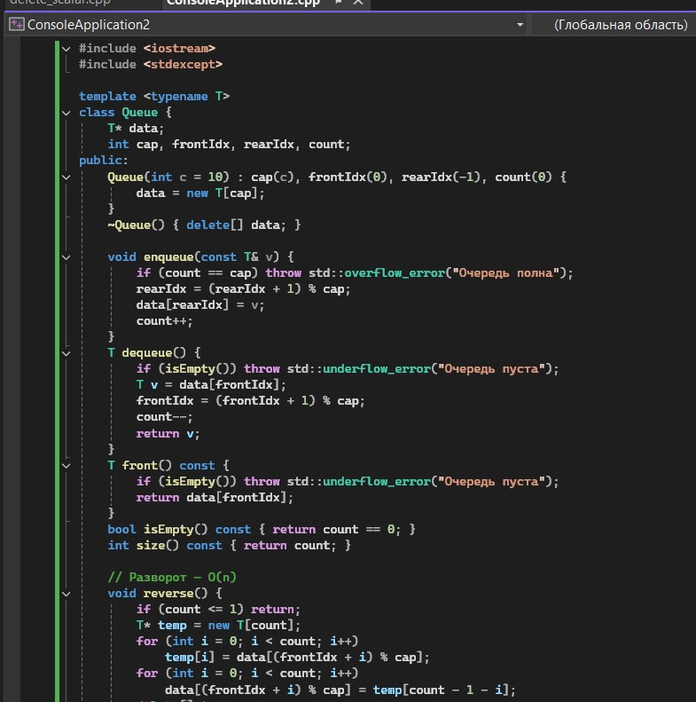

*Рисунок 3 – Код программы 2*

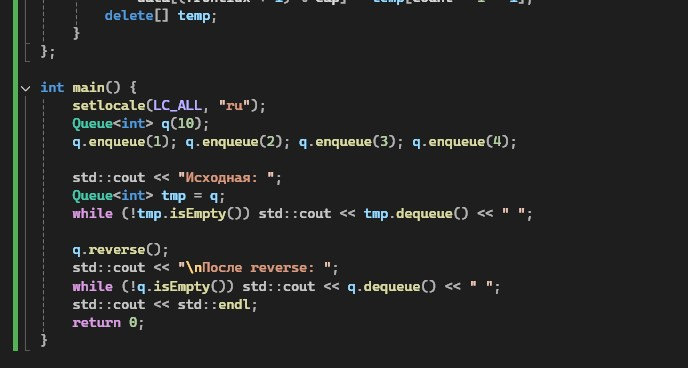

*Рисунок 4 – Код программы 2 (продолжение)*

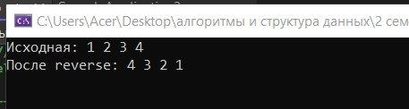

*Рисунок 5 – Результат работы программы2*

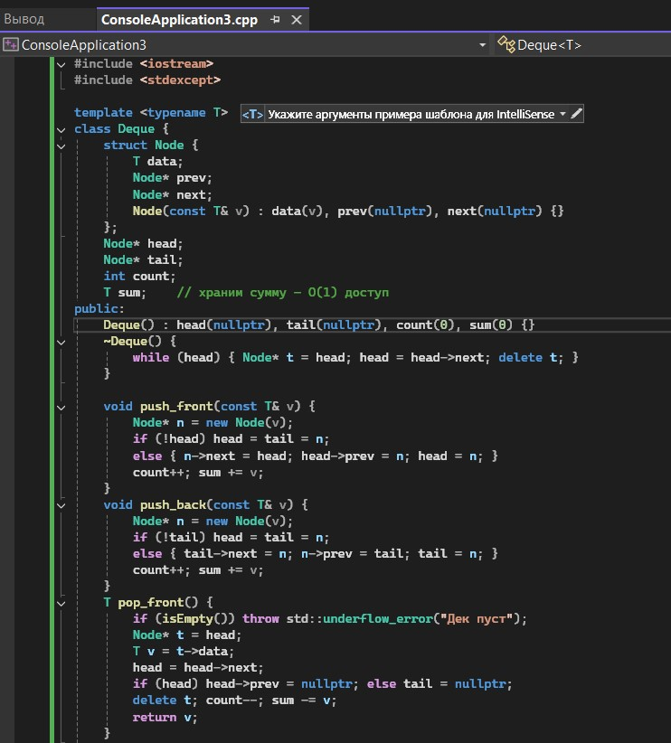

*Рисунок 6 – Код программы 3*

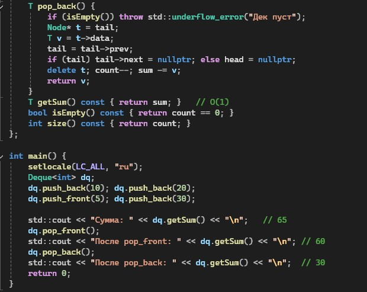

*Рисунок 7 – Код программы 3 (продолжение)*

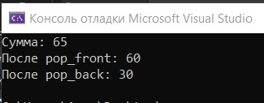

*Рисунок 8 – Результат работы программы4*

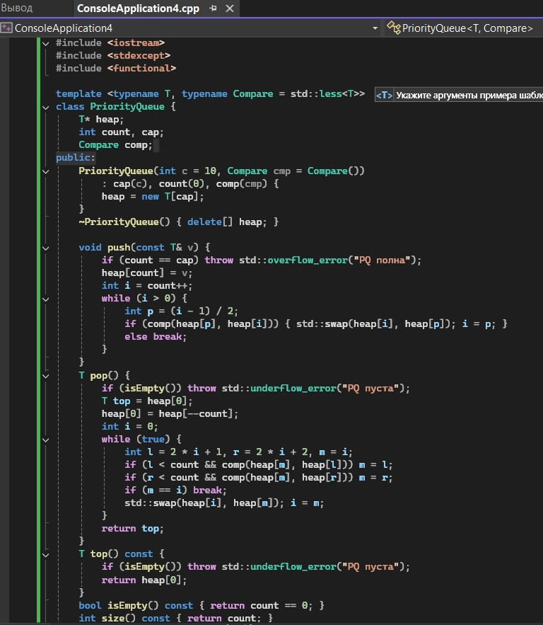

*Рисунок 9 – Код программы 4*

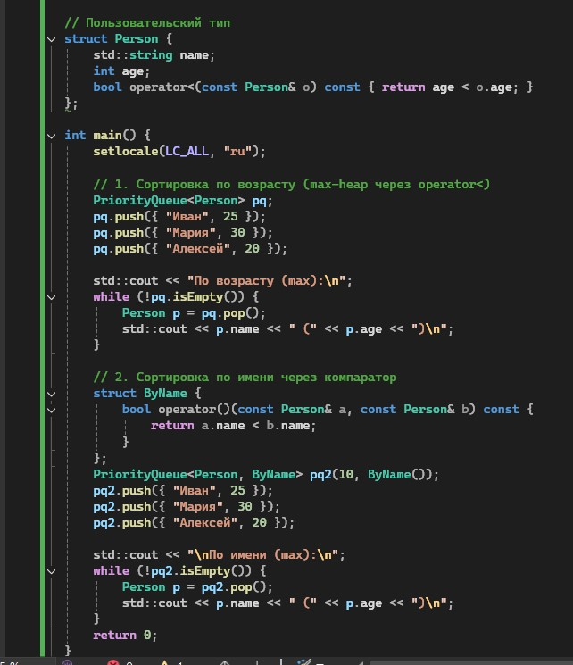

*Рисунок 10 – Код программы 4 (продолжение)*

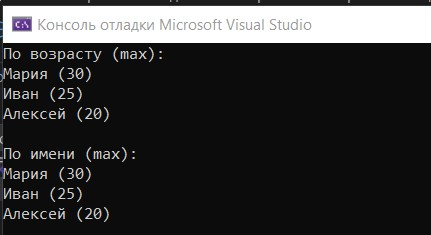

*Рисунок 11 – Результат работы программы 4*

---

##Анализ сложности всех операций

|Задание	|Операция|	Сложность|
| :--- | :--- | :--- |
|Два стека	|push/pop|	O(1)|
|Очередь + reverse	|enqueue/dequeue	|O(1)|
|Дек + сумма	|push/pop	|O(1)|
|PQ с компаратором	|push/pop|	O(log n)|

---

##Контрольные вопросы
**1. В чём заключается принцип работы стека (LIFO)?**
Стек организован по принципу LIFO (Last In – First Out): добавление и извлечение элементов происходит только с одного конца, называемого вершиной. Последний добавленный элемент извлекается первым, что обеспечивает доступ за O(1).

**2. В чём заключается принцип работы очереди (FIFO)?**
Очередь работает по принципу FIFO (First In – First Out): элементы добавляются в хвост, а извлекаются из головы. Первый добавленный элемент будет извлечён первым, что также даёт сложность O(1) для основных операций.

**3. Чем дек отличается от обычной очереди?**
Дек (double-ended queue) предоставляет возможность добавления и удаления элементов с обоих концов за O(1). В отличие от обычной очереди, где доступ ограничен хвостом и головой, дек позволяет реализовать как стек, так и очередь.

**4. Что такое приоритетная очередь? Где она применяется?**
Приоритетная очередь – это структура данных, в которой элементы извлекаются в соответствии с их приоритетом, а не порядком добавления. Она применяется в планировщиках задач, алгоритмах Дейкстры и Прима, а также в сжатии Хаффмана.

**5. Как реализовать стек на основе динамического массива?**
Стек на динамическом массиве хранит указатель на массив, индекс вершины и ёмкость. При добавлении элемента (push) увеличивается индекс вершины, при необходимости массив расширяется; при удалении (pop) индекс уменьшается.

**6. Как реализовать очередь на основе кольцевого буфера?**
Очередь на кольцевом буфере использует массив фиксированной ёмкости и два индекса – front и rear, которые перемещаются по кругу с помощью операции взятия остатка от деления на ёмкость. Это обеспечивает O(1) для enqueue и dequeue.

**7. Почему приоритетную очередь обычно реализуют на куче?**
Двоичная куча обеспечивает вставку и извлечение максимального (или минимального) элемента за O(log n), а доступ к экстремуму – за O(1). Это оптимальный баланс по сравнению с несортированным или сортированным массивом.

**8. Какова сложность операций push и pop в стеке?**
В стеке на массиве или связном списке операции push и pop выполняются за O(1) (амортизированно для push при расширении). Это обусловлено прямым доступом к вершине.

**9. Какова сложность операций enqueue и dequeue в очереди?**
При реализации на кольцевом буфере или связном списке с указателями на голову и хвост операции enqueue и dequeue имеют сложность O(1). Это достигается за счёт отсутствия необходимости обхода элементов.

**10. Какова сложность операций в приоритетной очереди?**
В приоритетной очереди на двоичной куче push и pop выполняются за O(log n), а top – за O(1). Это связано с необходимостью поддержания свойства кучи при вставке и удалении.

**11. Как проверить правильность расстановки скобок с помощью стека?**
Открывающие скобки помещаются в стек, а при встрече закрывающей проверяется соответствие с вершиной стека. Если после обработки всех символов стек пуст, то расстановка корректна.

**12. Как реализовать очередь на двух стеках? Какова сложность?**
Очередь на двух стеках использует один стек для входа (enqueue) и другой для выхода (dequeue). Enqueue выполняется за O(1), а dequeue – амортизированно за O(1), так как каждый элемент перекладывается не более одного раза.

**13. Как реализовать дек на основе двусвязного списка?**
Дек на двусвязном списке хранит указатели на голову и хвост, что позволяет добавлять и удалять элементы с обоих концов за O(1). Каждый узел содержит указатели на предыдущий и следующий элементы.

**14. Как реализовать дек на основе кольцевого буфера?**
Дек на кольцевом буфере использует массив фиксированной ёмкости и два индекса (front и back), которые перемещаются по кругу. Все операции добавления и удаления с обоих концов выполняются за O(1).

**15. Как реализовать стек с поддержкой получения минимума за O(1)?**
Для этого используется вспомогательный стек, в котором хранятся текущие минимумы. При добавлении элемента в основной стек в вспомогательный добавляется новый минимум, если он меньше или равен текущему; при удалении – синхронно удаляется. Это обеспечивает получение минимума за O(1).

---

## Вывод
* Реализовала основные линейные структуры данных: стек, очередь, дек и приоритетную очередь.
* Освоила принципы LIFO (стек) и FIFO (очередь).
* Научилась реализовывать эти структуры на основе динамического массива и связного списка.
* Изучила применение стека для решения задач (проверка скобок, обратная польская запись).
* Реализовала приоритетную очередь на основе кучи (heap).
