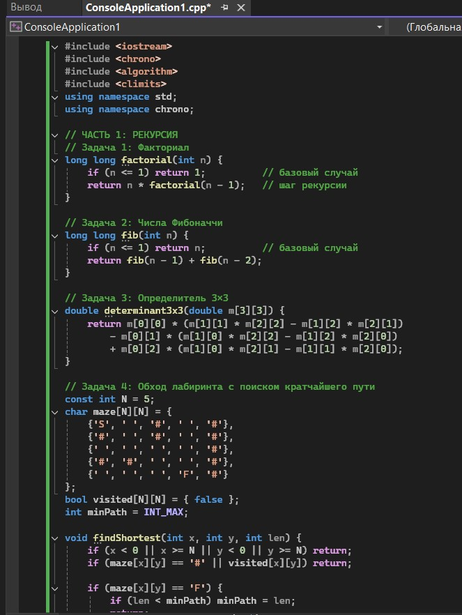
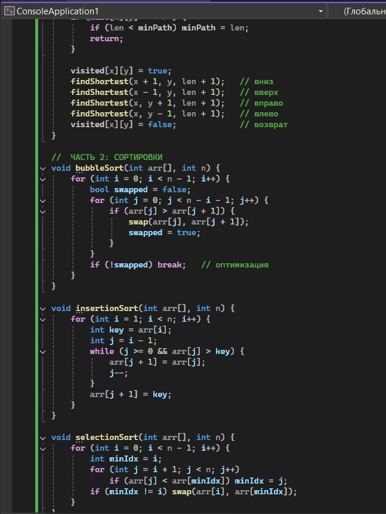
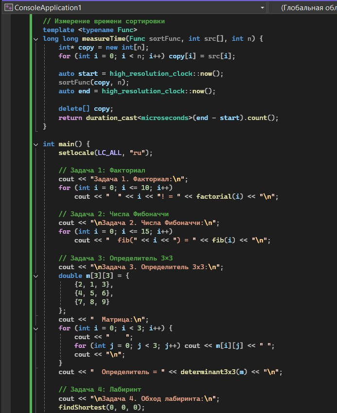
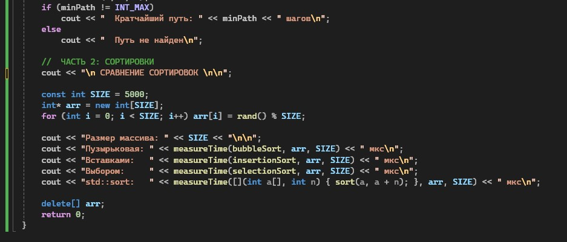
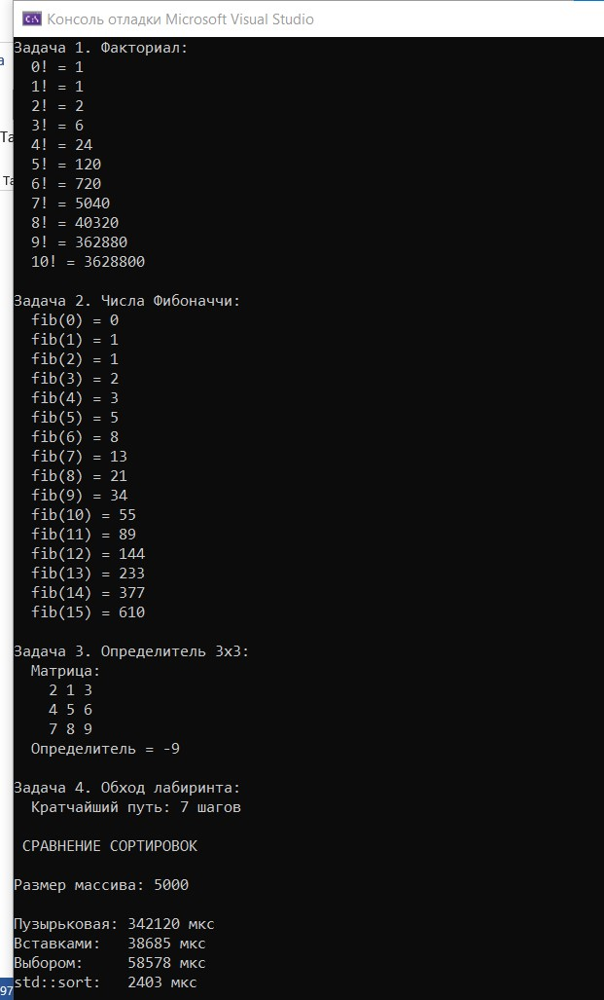

# Лабораторная работа №6

**Тема:** Рекурсивные алгоритмы. Простые сортировки  
**Дисциплина:** Алгоритмы и структуры данных  
**Вариант:** 14

**Выполнила:** Студент группы ПИЖ-б-о-25-1, направление подготовки: 09.03.04 «Программная инженерия» Калмазова Серафима Владимировна  
**Проверила:** ассистент кафедры программной инженерии Белик Ангелина Игоревна

*Ставрополь 2026*

---

## Цель работы

1. Освоить принципы рекурсии: прямой и косвенной, базовый случай и шаг рекурсии.
2. Научиться применять рекурсию для решения практических задач (факториал, числа Фибоначчи, Ханойские башни, обход лабиринта).
3. Реализовать и сравнить простые алгоритмы сортировки: пузырьковую, вставками, выбором.
4. Проанализировать сложность рекурсивных алгоритмов и простых сортировок.
5. Сравнить рекурсивную и итеративную реализации одних и тех же алгоритмов.

---

## Теоретическая часть

**Рекурсия** – это метод программирования, при котором функция вызывает саму себя для решения подзадач меньшего размера.

**Основные компоненты рекурсивной функции:**

| Компонент | Описание | Пример для факториала |
| :--- | :--- | :--- |
| **Базовый случай** | Условие остановки рекурсии | `if (n == 0) return 1;` |
| **Шаг рекурсии** | Вызов функции с меньшими параметрами | `return n * factorial(n - 1);` |

**Визуализация рекурсии (факториал 5):**
```text
factorial(5)
→ 5 * factorial(4)
→ 4 * factorial(3)
→ 3 * factorial(2)
→ 2 * factorial(1)
→ 1 * factorial(0)
→ 1 (базовый случай)
← 1 * 1 = 1
← 2 * 1 = 2
← 3 * 2 = 6
← 4 * 6 = 24
← 5 * 24 = 120
```

**Виды рекурсии:**

|Вид	|Описание|	Пример|
| :--- | :--- | :--- |
|Прямая рекурсия	|Функция вызывает саму себя	|factorial(n) вызывает factorial(n-1)|
|Косвенная рекурсия	|Функция А вызывает В, В вызывает А	|even(n) -> odd(n-1), odd(n) -> even(n-1)|
|Хвостовая рекурсия|	Рекурсивный вызов – последняя операция	|sum(n, acc) с аккумулятором|

**Классические рекурсивные задачи:**
Факториал:

```cpp
// Рекурсивно
int factorial(int n) {
    if (n <= 1) return 1;          // базовый случай
    return n * factorial(n - 1);   // шаг рекурсии
}
// Итеративно
int factorialIter(int n) {
    int result = 1;
    for (int i = 2; i <= n; i++) result *= i;
    return result;
}
```
Числа Фибоначчи:

```cpp
// Рекурсивно (экспоненциальная сложность O(2^n))
int fibRecursive(int n) {
    if (n <= 1) return n;
    return fibRecursive(n - 1) + fibRecursive(n - 2);
}
// Итеративно (линейная сложность O(n))
int fibIterative(int n) {
    if (n <= 1) return n;
    int a = 0, b = 1;
    for (int i = 2; i <= n; i++) {
        int c = a + b;
        a = b;
        b = c;
    }
    return b;
}
```

Ханойские башни:

```cpp
void hanoi(int n, char from, char to, char aux) {
    if (n == 1) {
        cout << "Переместить диск 1 с " << from << " на " << to << endl;
        return;
    }
    hanoi(n - 1, from, aux, to);
    cout << "Переместить диск " << n << " с " << from << " на " << to << endl;
    hanoi(n - 1, aux, to, from);
}
```

## Ход выполнения лабораторной работы
Ссылка на Git-репозиторий: https://github.com/serafima2007k-code/algoritms.git

**Индивидуальные задания (Вариант 14):**

**Часть 1. Рекурсивные алгоритмы:**
Задача 1 – Факториал числа.
Задача 2 – Числа Фибоначчи.
Задача 3 – Вычисление определителя (3×3).
Задача 4 – Обход лабиринта (с поиском кратчайшего пути).

**Часть 2. Простые сортировки:**

Сортировки для реализации: Пузырьковая, вставками, выбором.
Дополнительное задание: Сравнить производительность с std::sort.

### Листинг программы



*Рисунок 1 – Код программы*



*Рисунок 2 – Код программы (продолжение)*



*Рисунок 3 – Код программы (продолжение)*



*Рисунок 4 – Код программы (продолжение)*

### Результат работы программы


*Рисунок 5 – Результат работы программы*

---


## Анализ сложности всех операций

Факториал – сложность O(n). Каждый рекурсивный вызов уменьшает n на 1, количество вызовов равно n.
Числа Фибоначчи – сложность O(2ⁿ). Каждый вызов порождает два новых, образуя дерево вызовов экспоненциального размера.
Определитель 3×3 – сложность O(1). Фиксированное количество операций, не зависит от входных данных.
Обход лабиринта – сложность O(4^(N·N)). В худшем случае перебираются все пути из каждой клетки (4 направления).

## Сравнительная таблица сортировок:

|Алгоритм	|Лучший|	Средний|	Худший|	Память	|Устойчивость|
| :--- | :--- | :--- | :--- | :--- | :--- |
|Пузырьковая|	O(n)|	O(n²)	|O(n²)|	O(1)|	Да|
|Вставками|	O(n)	|O(n²)	|O(n²)	|O(1)|	Да|
|Выбором|	O(n²)	|O(n²)	|O(n²)|	O(1)|	Нет|
|std::sort|	O(n log n)|	O(n log n)|	O(n log n)|	O(n log n)|	Нет|

---

## Контрольные вопросы

**1. Что такое рекурсия? Из каких компонентов состоит рекурсивная функция?**
Рекурсия – метод, при котором функция вызывает саму себя. Компоненты: базовый случай (условие остановки) и шаг рекурсии (вызов с меньшими параметрами).

**2. Что такое базовый случай рекурсии? Почему он важен?**
Базовый случай – условие, при котором рекурсия прекращается. Без него функция будет вызывать себя бесконечно, что приведёт к переполнению стека.

**3. Чем отличается прямая рекурсия от косвенной?**
При прямой функция вызывает саму себя; при косвенной – через другую функцию (А вызывает В, В вызывает А).

**4. Что такое хвостовая рекурсия? В чём её преимущество?**
Хвостовая рекурсия – когда рекурсивный вызов является последней операцией. Преимущество: может быть оптимизирована компилятором в цикл, экономя память стека.

**5. Какова временная сложность рекурсивного вычисления чисел Фибоначчи? Почему?**
O(2ⁿ), так как каждый вызов порождает два новых, образуя дерево вызовов экспоненциального размера.

**6. Как можно оптимизировать рекурсивное вычисление Фибоначчи?**
Использовать мемоизацию (кэширование результатов) или итеративный подход.

**7. В чём отличие рекурсивной реализации от итеративной?**
Рекурсивная использует стек вызовов, итеративная – циклы. Рекурсия обычно компактнее, но может быть менее эффективной по памяти и скорости.

**8. Какова сложность пузырьковой сортировки? Когда она становится O(n)?**
В среднем и худшем случае O(n²). O(n) – если массив уже отсортирован (благодаря флагу swapped).

**9. Чем сортировка вставками отличается от сортировки выбором?**
Вставками ищет место для текущего элемента в отсортированной части; выбором ищет минимальный элемент в неотсортированной части и ставит его в начало.

**10. Какая из простых сортировок является устойчивой? Что это значит?**
Устойчивые: пузырьковая и вставками. Устойчивость означает сохранение относительного порядка равных элементов.

**11. Какая из простых сортировок работает лучше на почти отсортированных данных?**
Сортировка вставками – O(n) на почти отсортированных данных.

**12. Как реализовать пузырьковую сортировку с оптимизацией?**
Добавить флаг swapped, который показывает, были ли обмены на текущем проходе. Если обменов не было – массив отсортирован, выходим.

**13. Что такое рекурсивный поиск с возвратом (backtracking)?**
Метод, при котором мы пробуем разные варианты, и если заходим в тупик – возвращаемся назад и пробуем другой путь.

**14. Как рекурсивно обойти лабиринт?**
Из текущей клетки проверяем 4 направления, помечаем посещённые клетки, рекурсивно вызываем для соседних, при достижении финиша возвращаем true.

**15. Какова сложность Ханойских башен? Сколько ходов нужно для перемещения n дисков?**
Сложность O(2ⁿ). Количество ходов = 2ⁿ - 1.

---

## Вывод

*Освоила принципы рекурсии: прямой и косвенной, базовый случай и шаг рекурсии.
*Научилась применять рекурсию для решения практических задач (факториал, числа Фибоначчи, Ханойские башни, обход лабиринта).
*Реализовала и сравнила простые алгоритмы сортировки: пузырьковую, вставками, выбором.
*Проанализировала сложность рекурсивных алгоритмов и простых сортировок.
*Сравнила рекурсивную и итеративную реализации одних и тех же алгоритмов.
