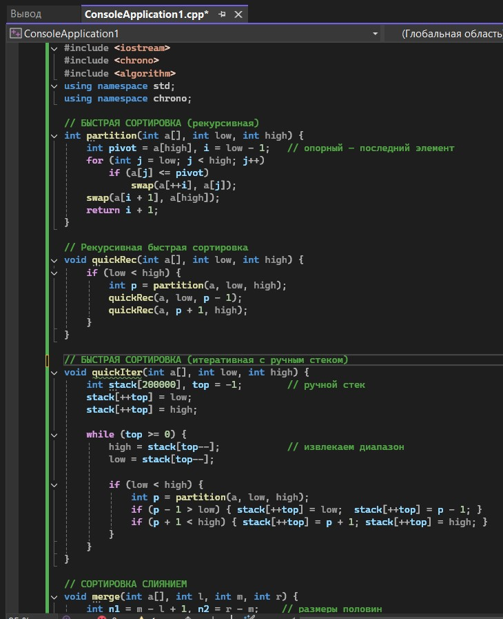
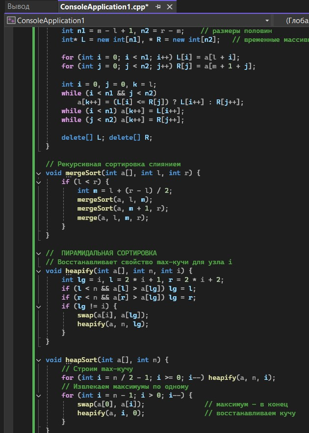
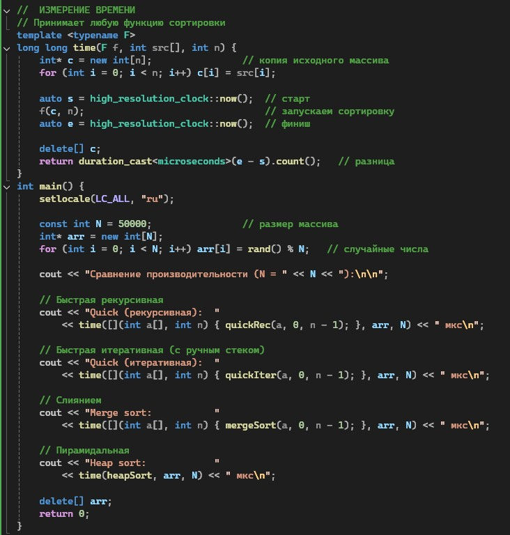
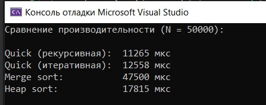

# Лабораторная работа №7

**Тема:** Быстрая сортировка, сортировка слиянием, пирамидальная сортировка  
**Дисциплина:** Алгоритмы и структуры данных  
**Вариант:** 9

**Выполнила:** Студент группы ПИЖ-6-о-25-1, направление подготовки: 09.03.04 «Программная инженерия» Калмазова Серафима Владимировна  
**Проверила:** ассистент кафедры программной инженерии Белик Ангелина Игоревна

*Ставрополь 2026*

---

## Цель работы

1. Реализовать три эффективных алгоритма сортировки: быструю сортировку (Quick Sort), сортировку слиянием (Merge Sort) и пирамидальную сортировку (Heap Sort).
2. Освоить принципы «разделяй и властвуй» на примере быстрой сортировки и сортировки слиянием.
3. Изучить структуру данных «куча» (heap) для реализации пирамидальной сортировки.
4. Проанализировать и сравнить производительность различных алгоритмов сортировки.
5. Понять преимущества и недостатки каждого алгоритма в различных сценариях использования.

---

## Теоретическая часть

### 1. Сравнение эффективных сортировок

| Алгоритм | Лучший случай | Средний случай | Худший случай | Память | Устойчивость |
| :--- | :--- | :--- | :--- | :--- | :--- |
| **Быстрая сортировка** | O(n log n) | O(n log n) | O(n²) | O(log n) | Нет |
| **Сортировка слиянием** | O(n log n) | O(n log n) | O(n log n) | O(n) | Да |
| **Пирамидальная** | O(n log n) | O(n log n) | O(n log n) | O(1) | Нет |

### 2. Быстрая сортировка (Quick Sort)

**Принцип «разделяй и властвуй»:**
1. Выбрать опорный элемент (pivot).
2. Разделить массив: элементы меньше pivot – слева, больше – справа.
3. Рекурсивно применить к левой и правой частям.

```cpp
int partition(int arr[], int low, int high) {
    int pivot = arr[high]; // опорный элемент (последний)
    int i = low - 1;       // индекс для меньших элементов
    for (int j = low; j < high; j++) {
        if (arr[j] <= pivot) {
            i++;
            swap(arr[i], arr[j]);
        }
    }
    swap(arr[i + 1], arr[high]);
    return i + 1;          // позиция опорного элемента
}

void quickSort(int arr[], int low, int high) {
    if (low < high) {
        int pi = partition(arr, low, high);
        quickSort(arr, low, pi - 1);
        quickSort(arr, pi + 1, high);
    }
}
```
**3. Сортировка слиянием (Merge Sort)**
Принцип:

Разделить массив пополам.

Рекурсивно отсортировать каждую половину.

Слить две отсортированные половины.

```cpp
void merge(int arr[], int left, int mid, int right) {
    int n1 = mid - left + 1;
    int n2 = right - mid;

    int* L = new int[n1];
    int* R = new int[n2];

    for (int i = 0; i < n1; i++) L[i] = arr[left + i];
    for (int j = 0; j < n2; j++) R[j] = arr[mid + 1 + j];

    int i = 0, j = 0, k = left;

    while (i < n1 && j < n2) {
        if (L[i] <= R[j]) arr[k++] = L[i++];
        else              arr[k++] = R[j++];
    }
    while (i < n1) arr[k++] = L[i++];
    while (j < n2) arr[k++] = R[j++];

    delete[] L;
    delete[] R;
}

void mergeSort(int arr[], int left, int right) {
    if (left < right) {
        int mid = left + (right - left) / 2;
        mergeSort(arr, left, mid);
        mergeSort(arr, mid + 1, right);
        merge(arr, left, mid, right);
    }
}
```

**4. Пирамидальная сортировка (Heap Sort)**
Принцип:

Построить двоичную кучу (max-heap) из массива.

Извлекать корень (максимальный элемент) и помещать в конец массива.

Восстанавливать свойство кучи.
Max-heap: родитель всегда больше или равен детям, корень – максимум.

```cpp
void heapify(int arr[], int n, int i) {
    int largest = i;
    int left = 2 * i + 1;
    int right = 2 * i + 2;

    if (left < n && arr[left] > arr[largest]) largest = left;
    if (right < n && arr[right] > arr[largest]) largest = right;

    if (largest != i) {
        swap(arr[i], arr[largest]);
        heapify(arr, n, largest);
    }
}

void heapSort(int arr[], int n) {
    // Построение кучи
    for (int i = n / 2 - 1; i >= 0; i--)
        heapify(arr, n, i);

    // Извлечение элементов
    for (int i = n - 1; i > 0; i--) {
        swap(arr[0], arr[i]);
        heapify(arr, i, 0);
    }
}
Итеративный heapify (вариант 9):
cpp
void heapifyIterative(int arr[], int n, int i) {
    while (true) {
        int largest = i;
        int left = 2 * i + 1;
        int right = 2 * i + 2;

        if (left < n && arr[left] > arr[largest]) largest = left;
        if (right < n && arr[right] > arr[largest]) largest = right;

        if (largest == i) break;

        swap(arr[i], arr[largest]);
        i = largest;
    }
}
```
Отличие от рекурсивной версии: цикл while(true) вместо рекурсивного вызова, экономит память стека.

## Ход выполнения лабораторной работы
Ссылка на Git-репозиторий: https://github.com/serafima2007k-code/algoritms.git

**Продвинутый уровень (Вариант 9)**
Общее задание: Реализовать все три сортировки с полной функциональностью и дополнительными возможностями. Провести углублённый анализ.
Дополнительные требования: Реализовать итеративную версию быстрой сортировки с ручным стеком.

### Листинг программы



*Рисунок 1 – Код программы*



*Рисунок 2 – Код программы (продолжение)*



*Рисунок 3 – Код программы (продолжение)*

### Результат работы программы



*Рисунок 4 – Результат работы программы*

---
## Анализ сложности всех операций
|Алгоритм|	Лучший|	Средний|	Худший	|Память|	Устойчивость|
| :--- | :--- | :--- | :--- |:--- |:--- |
|Quick (рекурсивная)|	O(n log n)	|O(n log n)|	O(n²)|	O(log n)|	Нет|
|Quick (итеративная)|	O(n log n)|	O(n log n)|	O(n²)	|O(n)| (ручной стек)|	Нет|
|Merge sort	O(n log n)|	O(n log n)	|O(n log n)|	O(n)|	Да|
|Heap sort	O(n log n)|	O(n log n)	|O(n log n)|	O(1)|	Нет|

## Контрольные вопросы
**1. Какова сложность быстрой сортировки в лучшем, среднем и худшем случае?**

Лучший: O(n log n) – pivot делит массив примерно пополам.

Средний: O(n log n).

Худший: O(n²) – pivot каждый раз минимальный или максимальный.

**2. Когда возникает худший случай для быстрой сортировки?**
Когда опорный элемент каждый раз оказывается минимальным или максимальным в подмассиве. Это происходит, например, если массив уже отсортирован, а pivot выбирается как последний элемент. Тогда глубина рекурсии = n, и на каждом уровне делается O(n) работы.

**3. Как можно улучшить быструю сортировку для защиты от худшего случая?**

Выбирать случайный опорный элемент.

Использовать медиану из трёх (первый, средний, последний).

Использовать интроспективную сортировку (переключение на heap sort при глубокой рекурсии).

**4. Какова сложность сортировки слиянием? Почему она всегда O(n log n)?**
Сортировка слиянием всегда O(n log n) во всех случаях. Массив делится пополам на log n уровней. На каждом уровне выполняется O(n) работы по слиянию. Итого: O(n) × O(log n) = O(n log n).

**5. Какие преимущества и недостатки имеет сортировка слиянием перед быстрой?**

Преимущества: Гарантированная O(n log n) в любом случае; Устойчивая (сохраняет порядок равных элементов).

Недостатки: Требует O(n) дополнительной памяти; На практике часто медленнее quick sort из-за копирования.

**6. Как работает пирамидальная сортировка? Какова её сложность?**
Сначала строится max-куча из массива за O(n). Затем корень (максимум) меняется с последним элементом, и куча восстанавливается для оставшихся n−1 элементов. Повторяем, пока куча не опустеет. Сложность: O(n log n) во всех случаях. Память: O(1) (сортировка на месте).

**7. Какая из трёх сортировок устойчивая? Почему?**
Сортировка слиянием – устойчивая. При слиянии, если L[i] == R[j], берём сначала L[i] (левый элемент), сохраняя порядок. Quick sort и heap sort – неустойчивые, потому что меняют равные элементы местами.

**8. Какая из трёх сортировок требует дополнительной памяти? Сколько?**
Сортировка слиянием – O(n) (временные массивы L и R). Быстрая сортировка – O(log n) (стек рекурсии). Пирамидальная – O(1) (сортировка на месте).

**9. Какая из трёх сортировок лучше работает на почти отсортированных данных?**
Быстрая сортировка с правильным выбором pivot работает быстрее всех. Но с pivot = последний элемент она деградирует до O(n²). Merge sort и heap sort всегда O(n log n). На практике для почти отсортированных данных лучше всего insertion sort (из простых сортировок).

**10. Зачем в пирамидальной сортировке сначала строится куча?**
Чтобы получить свойство max-heap: корень = максимальный элемент. Тогда извлечение максимума – O(log n). Без построения кучи невозможно быстро находить максимум.

**11. Что такое «разделяй и властвуй»? Как применяется?**
Разделяй и властвуй – стратегия: разбить задачу на подзадачи, решить их рекурсивно, объединить результаты.

Quick sort: разделяем по pivot, рекурсивно сортируем левую и правую части.

Merge sort: делим массив пополам, рекурсивно сортируем, сливаем.

**12. Можно ли реализовать быструю сортировку итеративно (без рекурсии)?**
Да, используя собственный стек для хранения диапазонов (low, high). Это экономит память стека вызовов и защищает от переполнения при большой глубине.

**13. Почему быстрая сортировка обычно быстрее сортировки слиянием на практике?**
У quick sort:

Хорошая локальность кэша (работает с подмассивами).

Нет копирования данных (в отличие от merge sort).

Меньше накладных расходов.
Поэтому даже при одинаковой O(n log n), quick sort обычно быстрее.

**14. Когда выгодно использовать пирамидальную сортировку?**

Когда нужно гарантированное O(n log n) без худшего случая.

Когда память ограничена (O(1)).

Во встроенных системах.

**15. Какой алгоритм сортировки вы бы выбрали для встроенных систем с ограниченной памятью?**
Пирамидальная сортировка – потому что она требует O(1) дополнительной памяти и всегда работает за O(n log n). Merge sort не подходит (O(n) памяти), quick sort может дать O(n²) в худшем случае.

## Вывод
*Реализовала три эффективных алгоритма сортировки: быструю сортировку (Quick Sort), сортировку слиянием (Merge Sort) и пирамидальную сортировку (Heap Sort).
*Освоила принципы «разделяй и властвуй» на примере быстрой сортировки и сортировки слиянием.
*Изучила структуру данных «куча» (heap) для реализации пирамидальной сортировки.
*Проанализировала и сравнила производительность различных алгоритмов сортировки.
*Поняла преимущества и недостатки каждого алгоритма в различных сценариях использования.
