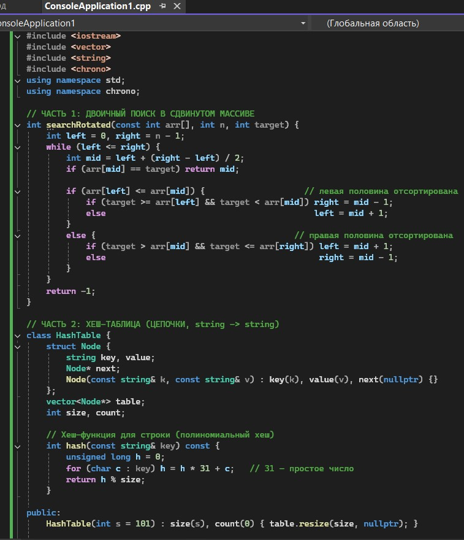
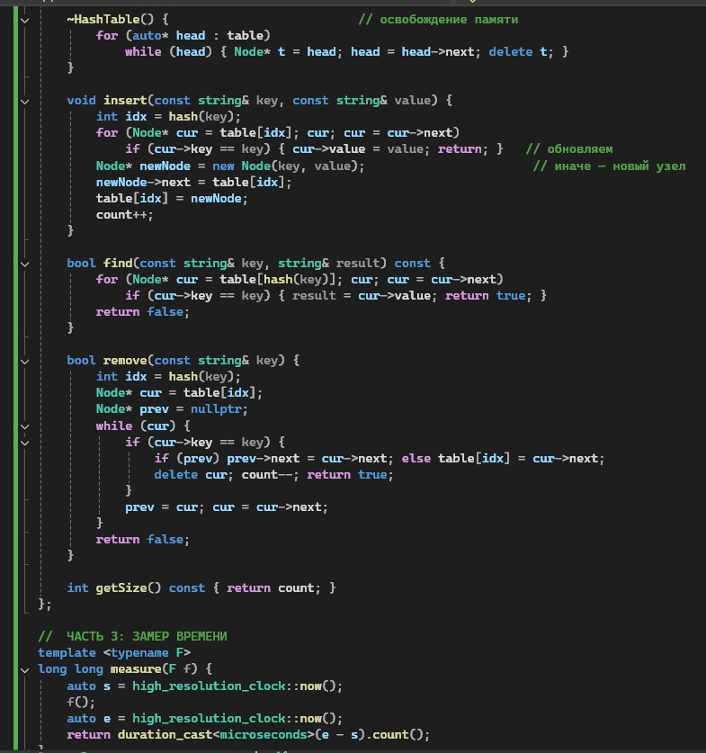
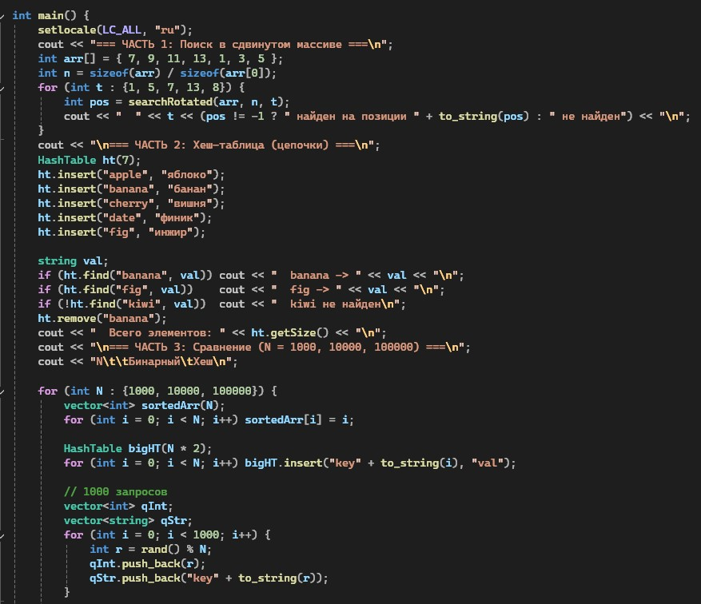
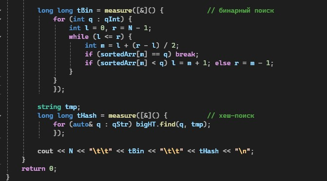
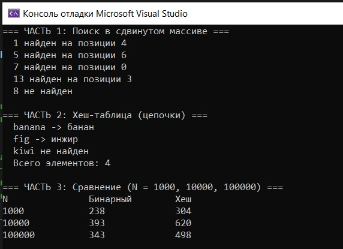

# Лабораторная работа №8

**Тема:** Двоичный поиск. Хеш-таблицы  
**Дисциплина:** Алгоритмы и структуры данных  
**Вариант:** 9

**Выполнила:** Студент группы ПИЖ-б-о-25-1, направление подготовки: 09.03.04 «Программная инженерия» Калмазова Серафима Владимировна  
**Проверила:** ассистент кафедры программной инженерии Белик Ангелина Игоревна

*Ставрополь 2026*

---

## Цель работы

1. Реализовать алгоритм двоичного (бинарного) поиска в отсортированном массиве.
2. Освоить итеративную и рекурсивную реализации двоичного поиска.
3. Изучить понятие хеш-таблицы, хеш-функции и методы разрешения коллизий.
4. Реализовать хеш-таблицу с методом цепочек и открытой адресацией.
5. Сравнить производительность двоичного поиска и хеш-таблицы.

---

## Теоретическая часть

### 1. Двоичный (бинарный) поиск

**Определение:** Двоичный поиск – это алгоритм поиска элемента в отсортированном массиве, который на каждом шаге делит интервал поиска пополам.

**Принцип работы:**
1. Находим средний элемент интервала поиска.
2. Сравниваем его с искомым значением.
3. Если равны – возвращаем индекс.
4. Если искомое больше – продолжаем поиск в правой половине.
5. Если меньше – в левой половине.

**Сложность:**
* Лучший случай – O(1) (элемент сразу в середине).
* Средний случай – O(log n).
* Худший случай – O(log n).
* Память (итеративно) – O(1).
* Память (рекурсивно) – O(log n) из-за стека вызовов.

### 2. Хеш-таблицы

**Определение:** Хеш-таблица – это структура данных, реализующая ассоциативный массив (словарь). Она хранит пары «ключ – значение» и поддерживает вставку, удаление и поиск в среднем за O(1).

**Основные компоненты:**
* **Хеш-функция** – преобразует ключ в индекс массива.
* **Бакет (bucket)** – ячейка массива, в которой хранятся данные.
* **Коллизия** – ситуация, когда разные ключи дают одинаковый индекс.

**Требования к хеш-функции:**
1. Быстро вычисляться.
2. Равномерно распределять ключи по бакетам.
3. Быть детерминированной (один ключ → всегда один индекс).

**Сложность операций:**
* Средняя – O(1).
* Худшая – O(n), если все ключи попали в один бакет.

### 3. Методы разрешения коллизий

**Метод цепочек**  
Каждый бакет – это связный список, при коллизии новый элемент добавляется в список этого бакета.  
*Преимущества:* Простота реализации, не требует перебора всех ячеек, работает даже при высокой загрузке.  
*Недостатки:* Дополнительная память на указатели, медленный доступ к памяти (узлы разбросаны).

**Открытая адресация**  
При коллизии ищется следующий свободный бакет по определённому правилу.
* **Линейное пробирование:** ищем `(hash + i) % size` – соседние ячейки.
* **Квадратичное пробирование:** `(hash + i²) % size` – шаг растёт квадратично.
* **Двойное хеширование:** `(hash1 + i * hash2) % size` – вторая хеш-функция задаёт шаг.

*Преимущества:* Не требует дополнительной памяти, хорошая локальность кэша (все данные в одном массиве).  
*Недостатки:* Кластеризация (скопление занятых ячеек), при высокой загрузке резко падает производительность.

### 4. Кластеризация

**Первичная кластеризация** возникает при линейном пробировании: занятые ячейки образуют длинные непрерывные блоки. Из-за этого новые коллизии присоединяются к этому блоку и увеличивают его.  
**Вторичная кластеризация** возникает при квадратичном пробировании: ключи с одинаковым начальным индексом идут по одинаковой последовательности, что приводит к скоплению в отдельных областях.  
Метод двойного хеширования практически не подвержен кластеризации, потому что шаг зависит от ключа.

### 5. Коэффициент загрузки

Коэффициент загрузки = количество элементов / размер таблицы.  
Он показывает, насколько таблица заполнена. Обычно поддерживают коэффициент ≤ 0.7. Если он превышает порог, выполняется **рехеширование**:
1. Создаётся новая таблица большего размера (обычно в 2 раза).
2. Все элементы перераспределяются по новым бакетам.

### 6. Хеш-функция для строк

Классический подход – полиномиальный хеш: `h = h * 31 + c`, где `c` – код символа, `31` – простое число.  
*Пример для строки "abc":*
```text
h = 0
h = 0 * 31 + 'a' = 97
h = 97 * 31 + 'b' = 3104
h = 3104 * 31 + 'c' = 96321
index = 96321 % size
```
Число 31 удобно тем, что умножение на него можно заменить сдвигом и вычитанием, что ускоряет работу.

## Ход выполнения лабораторной работы
Ссылка на Git-репозиторий: https://github.com/serafima2007k-code/algoritms.git

** Индивидуальные задания (Вариант 9):**

**Часть 1. Двоичный поиск:**

Тип данных – int.
Особенности – Поиск в циклически сдвинутом массиве.

**Часть 2. Хеш-таблицы:**
Метод разрешения коллизий – Метод цепочек.
Тип ключа – string.
Тип значения – string.

**Часть 3. Сравнительный анализ:**
Реализовать класс хеш-таблицы согласно варианту.
Реализовать двоичный поиск (итеративно).
Сравнить производительность операций поиска для N = 1000, 10000, 100000 элементов.
Двоичный поиск в отсортированном массиве.
Поиск в хеш-таблице.
Построить таблицу/график зависимости времени от N.

### Листинг программы



*Рисунок 1 – Код программы*



*Рисунок 2 – Код программы (продолжение)*



*Рисунок 3 – Код программы (продолжение)*



*Рисунок 4 – Код программы (продолжение)*

### Результат работы программы



*Рисунок 5 – Результат работы программы*

---

## Анализ сложности всех операций

|Структура / операция	|Средняя	|Худшая|	Память|
| :--- | :--- |:--- |:--- |
|Бинарный поиск (итеративный)|	O(log n)	|O(log n)	|O(1)|
|Бинарный поиск (рекурсивный)	|O(log n)	|O(log n)	|O(log n)|
|Поиск в сдвинутом массиве	|O(log n)	|O(log n)|	O(1)|
|Хеш-таблица: insert|	O(1 + L)	|O(n)	|O(n)|
|Хеш-таблица: find	|O(1 + L)|	O(n)|	O(n)|
|Хеш-таблица: remove	|O(1 + L)	|O(n)	|O(n)|
|Хеш-таблица: деструктор	|O(n + size)	|O(n + size)|	—|


## Контрольные вопросы
**1. Какое условие необходимо для применения двоичного поиска?**
Массив должен быть отсортирован (по возрастанию или убыванию).

**2. Какова сложность двоичного поиска? Почему она логарифмическая?**
O(log n). На каждом шаге область поиска сокращается вдвое, поэтому количество шагов равно log₂(n).

**3. В чём разница между итеративной и рекурсивной реализацией двоичного поиска?**
Итеративная использует цикл и O(1) памяти. Рекурсивная использует стек вызовов и O(log n) памяти. По скорости итеративная обычно чуть быстрее.

**4. Чем опасен вариант mid = (left + right) / 2? Как правильно вычислять середину?**
При больших left и right сумма может переполнить int. Правильно: left + (right - left) / 2.

**5. Что такое хеш-таблица? Из каких компонентов она состоит?**
Это структура для хранения пар «ключ — значение» с быстрым доступом. Компоненты: хеш-функция, массив бакетов, метод разрешения коллизий.

**6. Какие требования предъявляются к хеш-функции?**
Быстрота, равномерное распределение ключей, детерминированность.

**7. Что такое коллизия в хеш-таблице? Как с ней бороться?**
Коллизия — когда два разных ключа дают одинаковый индекс. Решается методом цепочек или открытой адресацией.

**8. В чём отличие метода цепочек от открытой адресации?**
Цепочки хранят список элементов в каждом бакете. Открытая адресация ищет следующую свободную ячейку в самом массиве.

**9. Что такое первичная и вторичная кластеризация?**
Первичная — при линейном пробировании образуются длинные блоки занятых ячеек. Вторичная — при квадратичном пробировании ключи скапливаются в отдельных областях.

**10. Какова средняя и худшая сложность операций в хеш-таблице?**
Средняя — O(1), худшая — O(n) (при всех коллизиях в один бакет).

**11. Когда эффективнее использовать двоичный поиск, а когда — хеш-таблицу?**
Двоичный поиск — для статичного отсортированного массива с редкими изменениями. Хеш-таблица — для динамических данных с частыми вставками и поисками.

**12. Что такое коэффициент загрузки хеш-таблицы? Почему он важен?**
Это отношение количества элементов к размеру таблицы. При высоком коэффициенте растёт число коллизий и падает производительность.

**13. Как работает рехеширование (динамическое расширение хеш-таблицы)?**
Создаётся новая таблица большего размера, и все элементы перераспределяются по новым бакетам через ту же хеш-функцию.

**14. Как выбрать размер хеш-таблицы? Почему часто выбирают простое число?**
Размер выбирают с запасом (коэффициент загрузки ≤ 0.7). Простое число уменьшает коллизии при делении по модулю.

**15. Как реализовать хеш-функцию для строк?**
Полиномиальный хеш: h = h * 31 + c, где c — код символа. Результат берётся по модулю размера таблицы.

## Вывод
* Реализовала алгоритм двоичного (бинарного) поиска в отсортированном массиве.
* Освоила итеративную и рекурсивную реализации двоичного поиска.
* Изучила понятие хеш-таблицы, хеш-функции и методы разрешения коллизий.

Реализовала хеш-таблицу с методом цепочек и открытой адресацией.

Сравнила производительность двоичного поиска и хеш-таблицы.
