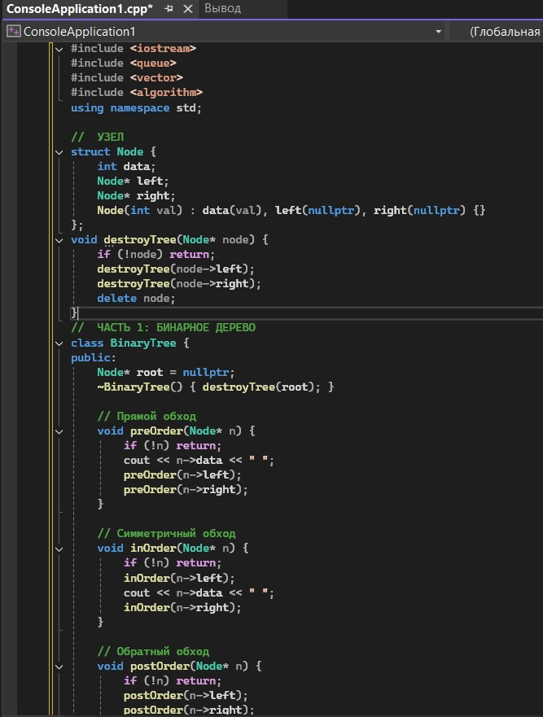
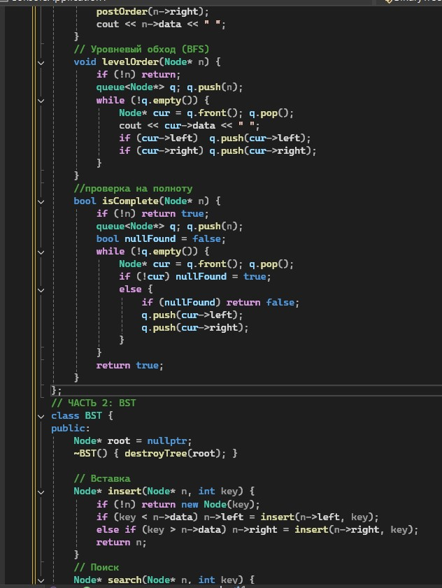
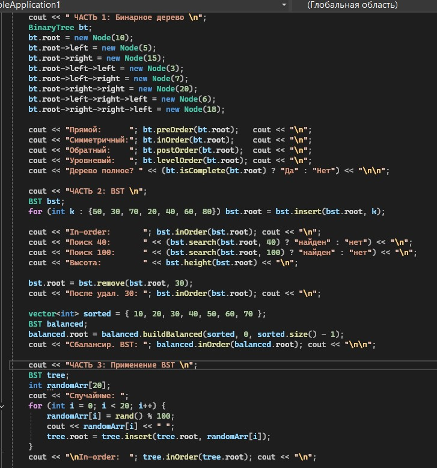
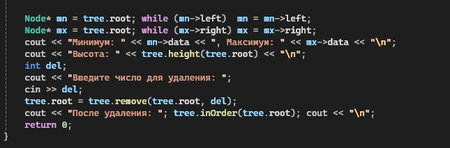
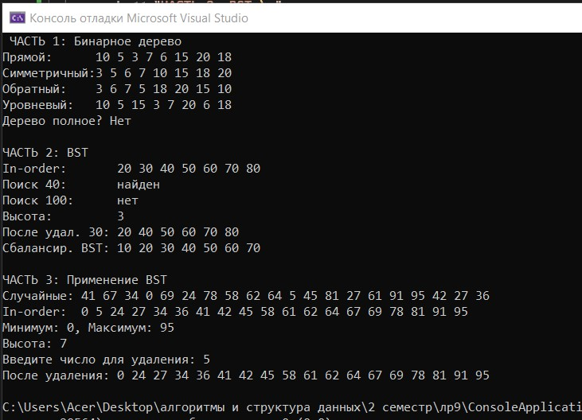

# Лабораторная работа №9

**Тема:** Бинарное дерево. Обходы. BST  
**Дисциплина:** Алгоритмы и структуры данных  
**Вариант:** 9

**Выполнила:** Студент группы ПИЖ-б-о-25-1, направление подготовки: 09.03.04 «Программная инженерия» Калмазова Серафима Владимировна  
**Проверила:** ассистент кафедры программной инженерии Белик Ангелина Игоревна

*Ставрополь 2026*

---

## Цель работы

1. Реализовать структуру данных «бинарное дерево» и изучить различные способы его обхода (прямой, симметричный, обратный, уровневый).
2. Реализовать бинарное дерево поиска (BST) с операциями вставки, удаления и поиска.
3. Освоить применение рекурсии для работы с деревьями.
4. Проанализировать сложность операций в BST.
5. Научиться визуализировать структуру дерева.

---

## Теоретическая часть

### 1. Бинарное дерево

**Бинарное дерево** – это иерархическая структура данных, в которой каждый узел имеет не более двух потомков: левый и правый. Такая структура напоминает перевёрнутое дерево: корень сверху, листья снизу.

**Основные термины:**
*   **Корень (root)** – верхний узел дерева, с которого начинается обход.
*   **Лист (leaf)** – узел без потомков (самый нижний).
*   **Внутренний узел** – узел, у которого есть хотя бы один потомок.
*   **Высота дерева** – максимальное расстояние от корня до самого дальнего листа.
*   **Уровень** – расстояние от корня (корень – уровень 0, его дети – уровень 1 и т.д.).

**Пример:**
```text
       10
      /  \
     5    15
    / \     \
   3   7     20
      /     /
     6     18
```
Здесь 10 – корень, 3, 6, 18 – листья, высота = 4.

**2. Обходы бинарного дерева**
Обход – это способ «посетить» все узлы дерева в определённом порядке. Существует четыре основных вида:

Прямой обход (pre-order): сначала посещаем корень, потом левое поддерево, потом правое. Порядок: корень → левый → правый. Для дерева выше результат: 10, 5, 3, 7, 6, 15, 20, 18.

Симметричный обход (in-order): сначала левое поддерево, потом корень, потом правое. Порядок: левый → корень → правый. Результат: 3, 5, 6, 7, 10, 15, 18, 20. Важно: для BST этот обход даёт отсортированную последовательность.

Обратный обход (post-order): сначала левое, потом правое, потом корень. Порядок: левый → правый → корень. Результат: 3, 6, 7, 5, 18, 20, 15, 10. Используется, например, для удаления дерева (сначала удаляем детей, потом родителя).

Уровневый обход (level-order): узлы посещаются по уровням, слева направо. Реализуется через очередь. Результат: 10, 5, 15, 3, 7, 20, 6, 18.

**3. Бинарное дерево поиска (BST)**
BST – это бинарное дерево, в котором для каждого узла выполняется правило:

Все ключи в левом поддереве меньше ключа узла, а все ключи в правом поддереве больше.

Пример BST:

```text
        50
       /  \
      30   70
     / \   / \
    20 40 60 80
```
Свойства BST:

Симметричный обход (in-order) даёт отсортированную последовательность.

Поиск, вставка и удаление в среднем работают за O(log n) – как бинарный поиск в отсортированном массиве.

В худшем случае (если дерево вырождается в список) – O(n).

**4. Операции с BST**
Поиск: сравниваем ключ с текущим узлом. Если равен – нашли. Если меньше – идём в левое поддерево, если больше – в правое. Рекурсивно или циклом.

Вставка: идём по дереву как при поиске, пока не найдём пустое место (nullptr), и вставляем новый узел туда. Дубликаты обычно не вставляются.

Удаление: три случая:

Лист – просто удаляем узел.
Один ребёнок – заменяем узел его единственным ребёнком.
Два ребёнка – находим минимальный узел в правом поддереве (или максимальный в левом), копируем его значение в удаляемый узел, а затем удаляем этот минимальный узел рекурсивно.

**5. Вычисление характеристик дерева**
Высота: 0 для пустого дерева, иначе 1 + max(высота левого, высота правого).

Количество узлов: 0 для пустого, иначе 1 + узлы слева + узлы справа.

Количество листьев: лист – узел без детей. Если узел лист – возвращаем 1, иначе сумму листьев левого и правого поддеревьев.

**6. Сбалансированные деревья**
Сбалансированное дерево – дерево, в котором разница высот левого и правого поддеревьев у каждого узла не превышает 1.
Почему важно: если дерево сбалансировано, высота = O(log n), и все операции выполняются за O(log n).

Чтобы построить сбалансированное BST из отсортированного массива, берём средний элемент как корень, левую половину – в левое поддерево, правую – в правое, и так рекурсивно. Это даёт минимальную высоту log₂(n).

## Ход выполнения лабораторной работы
Ссылка на Git-репозиторий: https://github.com/serafima2007k-code/algoritms.git

**Индивидуальные задания (Вариант 9):**

**Часть 1. Бинарное дерево и обходы:**

Обязательные операции – preOrder, inOrder, postOrder, levelOrder.
Дополнительное задание – Проверить, является ли дерево полным.

**Часть 2. Бинарное дерево поиска (BST):**

Обязательные операции – insert, search, inOrder, remove.
Дополнительное задание – Построение BST из отсортированного массива (сбалансированно).

**Часть 3. Применение BST:**

Создаёт BST из последовательности случайных чисел (N = 20).
Выполняет симметричный обход и выводит отсортированную последовательность.
Находит минимальный и максимальный элемент.
Находит высоту дерева.
Удаляет элемент, введённый пользователем, и выводит дерево после удаления.
### Листинг программы



*Рисунок 1 – Код программы*



*Рисунок 2 – Код программы (продолжение)*



*Рисунок 3 – Код программы (продолжение)*



*Рисунок 4 – Код программы (продолжение)*

### Результат работы программы



*Рисунок 5 – Результат работы программы*

---


## Анализ сложности всех операций
|Операция|	Средний случай|	Худший случай|
| :--- | :--- |:--- |
|Поиск в BST	|O(log n)	|O(n)|
|Вставка в BST	|O(log n)|	O(n)|
|Удаление в BST|	O(log n)|	O(n)|
|Обходы (pre, in, post, level)	|O(n)	|O(n)|
|Построение сбалансированного BST	|O(n)	|O(n)|
|Проверка на полноту|	O(n)|	O(n)|

## Контрольные вопросы
**1. Что такое бинарное дерево? Из каких элементов оно состоит?**
Бинарное дерево – это иерархическая структура данных, в которой каждый узел имеет не более двух потомков: левого и правого. Состоит из узлов, каждый из которых хранит данные и два указателя (на левого и правого ребёнка). Верхний узел называется корнем, узлы без детей – листьями.

**2. В чём отличие бинарного дерева от бинарного дерева поиска (BST)?**
Обычное бинарное дерево не накладывает никаких ограничений на расположение значений – данные могут быть в любом порядке. BST же требует, чтобы для каждого узла все значения в левом поддереве были меньше значения узла, а все в правом – больше. Это свойство делает BST удобным для быстрого поиска.

**3. Какие существуют виды обхода бинарного дерева? В чём их особенности?**
Четыре вида:

Pre-order (корень → левый → правый) – используется для копирования дерева.
In-order (левый → корень → правый) – для BST даёт отсортированную последовательность.
Post-order (левый → правый → корень) – для удаления дерева (сначала дети, потом родитель).
Level-order (по уровням, BFS) – для обхода в ширину, реализуется через очередь.

**4. Какой обход даёт отсортированную последовательность для BST?**
Симметричный обход (in-order). Это свойство вытекает из определения BST: левое поддерево содержит меньшие элементы, правое – большие, а мы посещаем их в порядке «левый – корень – правый».

**5. Какова сложность операций поиска, вставки и удаления в BST? От чего она зависит?**
В среднем – O(log n), в худшем – O(n). Зависит от высоты дерева, которая, в свою очередь, зависит от порядка вставки. Если вставлять случайные элементы – высота ≈ log n. Если вставлять по возрастанию – дерево вырождается в список длины n.

**6. Что происходит с BST, если вставлять элементы в отсортированном порядке?**
Дерево вырождается в односвязный список. Каждый новый узел становится правым ребёнком предыдущего. Высота становится n, и все операции деградируют до O(n). Это главный недостаток обычного BST.

**7. Какие три случая нужно рассмотреть при удалении узла из BST?**

Узел – лист (нет детей): просто удаляем его.

Узел имеет одного ребёнка: заменяем узел его ребёнком.

Узел имеет двух детей: находим минимальный узел в правом поддереве (или максимальный в левом), копируем его значение в удаляемый узел, а затем рекурсивно удаляем этот минимальный узел.

**8. Как найти наименьший элемент в BST? Наибольший?**
Наименьший – идём от корня влево, пока есть левый ребёнок. Последний узел и будет минимумом. Наибольший – идём вправо, пока есть правый ребёнок.

**9. Как вычислить высоту бинарного дерева рекурсивно?**
Если узел пуст – высота 0. Иначе: 1 + max(высота левого, высота правого). Рекурсивно применяем к обоим поддеревьям и берём максимум.

**10. Что такое наименьший общий предок (LCA) двух узлов в дереве?**
LCA – это самый глубокий узел, который является предком обоих заданных узлов. Для BST его легко найти: если оба узла меньше текущего – идём влево, если оба больше – вправо, иначе текущий узел и есть LCA.

**11. Как проверить, является ли бинарное дерево BST?**
Основной способ – выполнить in-order обход и проверить, что полученная последовательность строго возрастает. Если хотя бы одна пара идёт не по порядку – это не BST. Альтернативно можно передавать в рекурсию диапазон допустимых значений (min, max) для каждого узла.

**12. Что такое сбалансированное дерево? Почему это важно для производительности?**
Сбалансированное дерево – такое, в котором разница высот левого и правого поддеревьев у каждого узла не больше 1. Это важно, потому что от высоты зависит сложность операций: при высоте log n операции работают за O(log n), а при вырождении в список – за O(n).

**13. Как преобразовать несбалансированное BST в сбалансированное?**
Нужно выполнить in-order обход несбалансированного дерева и сохранить элементы в массив (они будут отсортированы). Затем рекурсивно строить новое дерево: средний элемент массива становится корнем, левая половина – левым поддеревом, правая – правым. Это даёт сбалансированное дерево за O(n).

**14. Как восстановить дерево по массиву обхода (in-order + pre-order)?**
Первый элемент pre-order – это корень. Находим его в in-order – всё, что слева от него, принадлежит левому поддереву, всё, что справа – правому. Рекурсивно повторяем для каждой части, используя соответствующие фрагменты pre-order и in-order. Аналогично можно восстановить по in-order + post-order.

**15. Как реализовать итеративный (не рекурсивный) обход бинарного дерева?**
Используя собственный стек (или очередь для level-order).

Для pre-order: кладём корень в стек, затем в цикле извлекаем узел, выводим, кладём сначала правого, потом левого ребёнка.

Для in-order: идём влево, складывая узлы в стек, пока есть левый ребёнок, затем извлекаем из стека, выводим и переходим к правому поддереву.

Для post-order: используется два стека или один стек с маркерами.

Для level-order: используется очередь.

## Вывод
* Реализовала структуру данных «бинарное дерево» и изучила различные способы его обхода (прямой, симметричный, обратный, уровневый).
* Реализовала бинарное дерево поиска (BST) с операциями вставки, удаления и поиска.
* Освоила применение рекурсии для работы с деревьями.
* Проанализировала сложность операций в BST.
* Научилась визуализировать структуру дерева.
